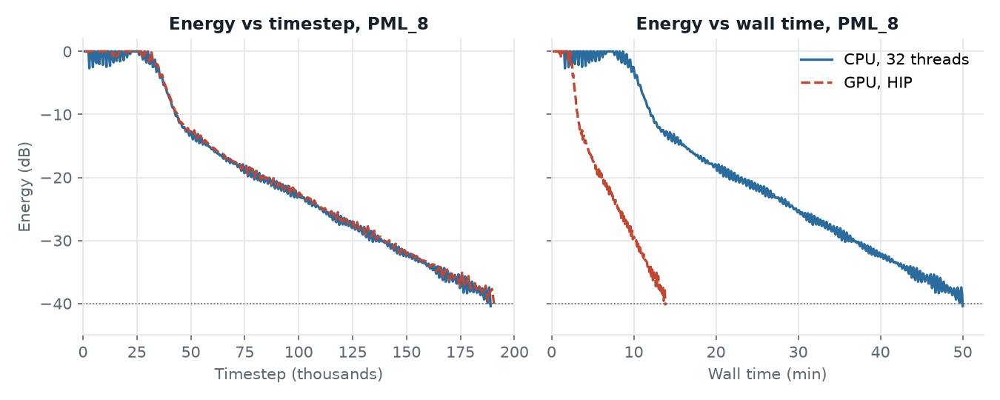
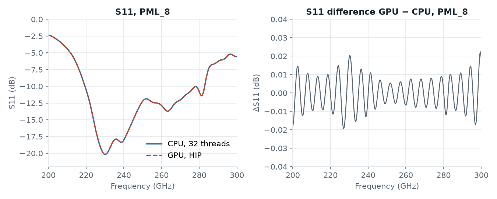
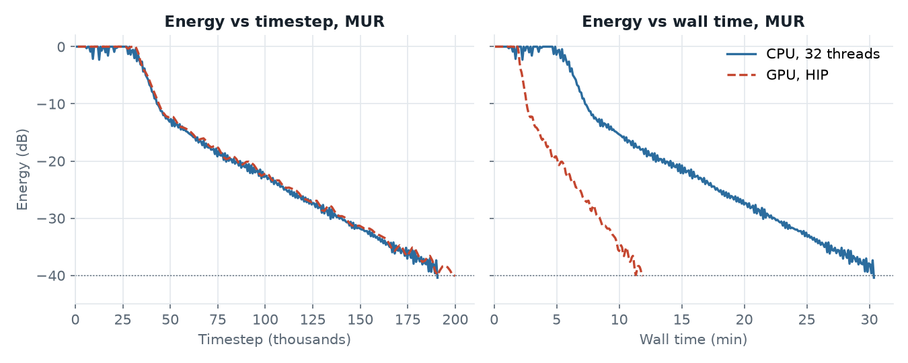
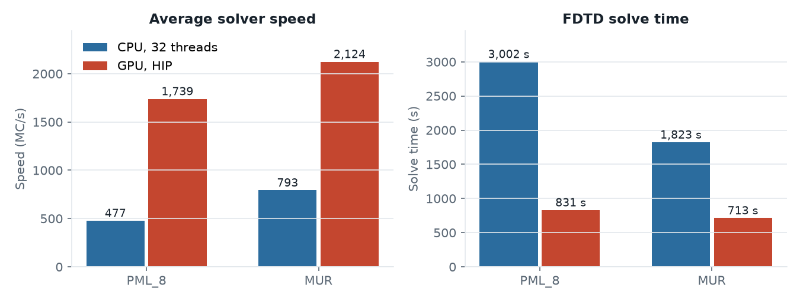
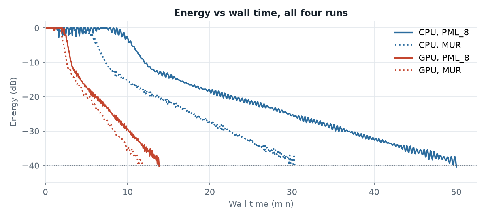
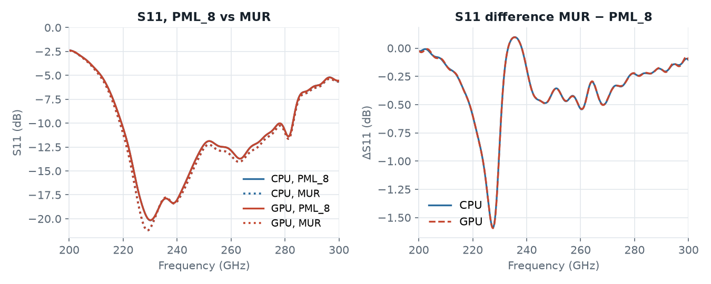
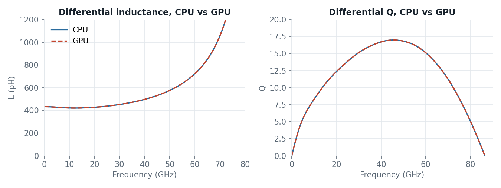

# GPU engine: CPU vs GPU benchmarks

`settings['engine'] = 'gpu'` runs openEMS on its GPU engine (Metal on macOS, HIP on AMD and NVIDIA GPUs) instead of the default multithreaded CPU engine:

```python
settings['engine'] = 'gpu'   # omitted: openEMS default (multithreaded CPU engine)
```

The GPU engine is not in an openEMS release yet (v0.37.0 doesn't have it), so openEMS has to be built from its current source code. See [Running on the GPU](../../doc/userguide_md_format/Using_OpenEMS_Python_with_IHP_SG13G2_v3.md#running-on-the-gpu) in the user's guide.

This folder has two models, each simulated with the CPU engine and with the GPU engine:

| Folder | Model | Scripts |
|---|---|---|
| [`dual_dipole`](dual_dipole) | Dual dipole antenna at 245 GHz, 7.58 M cells, `PML_8` and `MUR` boundaries | [`openEMS_dual_dipole_pml_cpu.py`](dual_dipole/openEMS_dual_dipole_pml_cpu.py), [`openEMS_dual_dipole_pml_gpu.py`](dual_dipole/openEMS_dual_dipole_pml_gpu.py), [`openEMS_dual_dipole_mur_cpu.py`](dual_dipole/openEMS_dual_dipole_mur_cpu.py), [`openEMS_dual_dipole_mur_gpu.py`](dual_dipole/openEMS_dual_dipole_mur_gpu.py) |
| [`ind500p`](ind500p) | Octagon inductor with center tap, 2 via ports, 0.79 M cells, `PEC` boundaries | [`openEMS_500pH_cpu.py`](ind500p/openEMS_500pH_cpu.py), [`openEMS_500pH_gpu.py`](ind500p/openEMS_500pH_gpu.py) |

All runs were on the same machine: AMD Ryzen AI Max+ PRO 395 with integrated Radeon 8060S GPU (HIP backend), Linux.

## Dual dipole 245 GHz

The same IHP SG13G2 dual-dipole antenna model, solved with the default multithreaded CPU engine and with `settings['engine'] = 'gpu'` (HIP backend), each with `PML_8` and with `MUR` boundaries.

| Boundaries | CPU, 32 threads | GPU, HIP | Speedup (solve time) | Largest S11 difference GPU vs CPU |
|---|---|---|---|---|
| `PML_8` | 477 MC/s, 3,002 s | 1,739 MC/s, 831 s | **3.6×** | 0.022 dB (1.6e-3 linear) |
| `MUR` | 793 MC/s, 1,823 s | 2,124 MC/s, 713 s | **2.6×** | 0.037 dB (2.4e-3 linear) |

- The GPU engine is 3.6× faster with `PML_8` and 2.6× faster with `MUR`.
- Switching from `PML_8` to `MUR` speeds up the CPU engine by 66 % but the GPU engine by only 22 %, so the GPU advantage shrinks with `MUR`.
- With either boundary, both engines converge the same per timestep and give the same results. S11 agrees within 0.04 dB, directivity within 0.011 dB, and efficiency within 0.02 %-points.
- The boundary type changes the result far more than the engine does: S11 with `MUR` differs from `PML_8` by up to 1.6 dB.

### Test setup

| Item | Value |
|---|---|
| Model | Dual dipole 245 GHz (IHP design, K. Schmalz), `dipole_port_sg13.gds`, stackup `SG13G2_200um_backsideGND.xml` |
| Mesh | 259 × 259 × 113 = 7.58 M cells, smallest cell 2.07 × 2.50 × 0.40 µm (same for all four runs) |
| Timestep | 1.258 fs; excitation 45,561 timesteps (57.3 ps), Gaussian 200–300 GHz |
| Boundaries | `PML_8` or `MUR` on all six sides; NF2FF box at 245 GHz |
| End criterion | `energy_limit = -40` dB |
| openEMS | v0.37.0-33-g53a4264 (GPU engine build), CSXCAD v0.7.0-8 |
| gds2openEMS | 0.6.3 |
| CPU engine | Compressed SSE + multithreading, `numThreads = 0` (auto, 32 threads) |
| GPU engine | `settings['engine'] = 'gpu'`, HIP backend, Radeon 8060S (integrated, shared memory) |
| Host | AMD Ryzen AI Max+ PRO 395, 107 GB RAM, Linux 7.0.0-38 |

The four model scripts differ only in `settings['engine']` and `settings['Boundaries']`:

| Script | `settings['engine']` | `settings['Boundaries']` |
|---|---|---|
| `openEMS_dual_dipole_pml_cpu.py` | not set (commented out) | `PML_8` on all six sides |
| `openEMS_dual_dipole_pml_gpu.py` | `'gpu'` | `PML_8` on all six sides |
| `openEMS_dual_dipole_mur_cpu.py` | not set (commented out) | `MUR` on all six sides |
| `openEMS_dual_dipole_mur_gpu.py` | `'gpu'` | `MUR` on all six sides |

For this benchmark all of them also set:

```python
settings['resonance_estimation'] = False   # all runs go to the -40 dB energy limit
settings['no_gui'] = True                  # no AppCSXCAD preview (batch run)
settings['force_simulation'] = True        # always re-run, no cached results
```

The runs were sequential on an otherwise idle machine: PML CPU, PML GPU, MUR CPU, MUR GPU. The CPU and the integrated GPU share memory bandwidth, so overlapping runs would skew the timings.

### PML_8 boundaries

#### Speed


The GPU engine ran at a steady 1,739 MC/s from the first progress line, with two short dips to ~1,640 MC/s. The CPU engine needed about 2 minutes to reach its plateau of ~490 MC/s, then fluctuated between ~420 and ~515 MC/s.

| | CPU | GPU | GPU / CPU |
|---|---|---|---|
| Average speed (openEMS summary) | 477.3 MC/s | 1,739.0 MC/s | 3.64× |
| Steady state, after 2 min (mean ± σ) | 486 ± 16 MC/s | 1,739 ± 18 MC/s | 3.58× |
| Time per timestep | 15.9 ms | 4.36 ms | 3.64× |
| FDTD solve time | 3,001.6 s | 831.1 s | 3.61× |
| Total wall time incl. setup + NF2FF | 50:40 | 14:28 | 3.50× |
| Peak host memory (RSS) | 1.19 GB | 1.52 GB | |

#### Convergence



Per timestep, the energy decay curves of the two engines lie on top of each other, so the GPU gains only in wall time. After the excitation ends near 45k timesteps, the energy falls at about 2 dB per 10k timesteps. That is the slow tail of a resonant structure, so most of the run time is spent here.

| Energy reached | CPU timestep | GPU timestep | CPU time | GPU time | Time ratio |
|---|---|---|---|---|---|
| −10 dB | 43,030 | 44,685 | 726 s | 194 s | 3.7× |
| −20 dB | 79,440 | 79,440 | 1,300 s | 347 s | 3.7× |
| −30 dB | 134,386 | 140,013 | 2,143 s | 610 s | 3.5× |
| −40 dB (end) | 189,001 | 190,656 | 3,001 s | 831 s | 3.6× |

The GPU engine reports progress and checks the end criterion only every 993 timesteps; the CPU engine does so every 331. So the GPU run detects each threshold slightly later. The 1,655 extra GPU timesteps at −40 dB are less than two of its check intervals.

#### Result agreement



The S11 curves overlap within line width. Both have their minimum of about −20.15 dB at 230 GHz, and the largest difference is 0.022 dB (1.6e-3 linear). The difference is a periodic ripple, not a trend. It is consistent with the two runs stopping at different timesteps, which truncates the slowly decaying port signals at different points before the DFT. This matches the Apple M4 (Metal) results in the user's guide.

| At 245 GHz | CPU | GPU | Difference |
|---|---|---|---|
| Directivity D<sub>max</sub> | 8.0890 dBi | 8.0871 dBi | −0.002 dB |
| Radiation efficiency | 77.544 % | 77.555 % | +0.010 %-pt |
| Mismatch loss | −0.1403 dB | −0.1403 dB | < 0.001 dB |
| S11 minimum | −20.168 dB @ 230 GHz | −20.149 dB @ 230 GHz | +0.020 dB |

### MUR boundaries

#### Speed


The GPU engine ran at 2,124 ± 6 MC/s, even steadier than with `PML_8`. The CPU engine reached its plateau within about 45 s and then ran at 801 ± 23 MC/s.

| | CPU | GPU | GPU / CPU |
|---|---|---|---|
| Average speed (openEMS summary) | 792.8 MC/s | 2,124.1 MC/s | 2.68× |
| Steady state, after 2 min (mean ± σ) | 801 ± 23 MC/s | 2,124 ± 6 MC/s | 2.65× |
| Time per timestep | 9.56 ms | 3.57 ms | 2.68× |
| FDTD solve time | 1,822.9 s | 713.5 s | 2.56× |
| Total wall time incl. setup + NF2FF | 30:37 | 12:06 | 2.53× |
| Peak host memory (RSS) | 1.05 GB | 1.26 GB | |

The solve-time ratio (2.56×) is a little lower than the speed ratio (2.68×) because the GPU run took 9,268 more timesteps to reach the end criterion. See the next section.

#### Convergence



| Energy reached | CPU timestep | GPU timestep | CPU time | GPU time | Time ratio |
|---|---|---|---|---|---|
| −10 dB | 43,030 | 45,016 | 437 s | 160 s | 2.7× |
| −20 dB | 79,440 | 86,060 | 776 s | 307 s | 2.5× |
| −30 dB | 134,386 | 142,992 | 1,291 s | 510 s | 2.5× |
| −40 dB (end) | 190,656 | 199,924 | 1,823 s | 713 s | 2.6× |

With `MUR`, the GPU engine checks the end criterion every 1,324 timesteps and the CPU engine every 662. The GPU run stopped 9,268 timesteps (7 check intervals) later. That is more than the check interval alone explains, so the energy was compared at matched timesteps. The two engines differ by at most ±0.7 dB, alternating in sign, with no systematic drift (the `PML_8` pair: ±0.4 dB). Near the end the energy wobbles by 1–2 dB from one progress line to the next, so where each run first drops below −40 dB depends on which timesteps it samples. The engines converge the same; their end-criterion checks just fall on different points.

#### Result agreement


Both engines have their S11 minimum of −21.22 dB at 229 GHz. The largest difference is 0.037 dB (2.4e-3 linear), again a periodic ripple that grows toward the band edges.

| At 245 GHz | CPU | GPU | Difference |
|---|---|---|---|
| Directivity D<sub>max</sub> | 8.4440 dBi | 8.4551 dBi | +0.011 dB |
| Radiation efficiency | 77.253 % | 77.237 % | −0.017 %-pt |
| Mismatch loss | −0.1258 dB | −0.1258 dB | < 0.001 dB |
| S11 minimum | −21.220 dB @ 229 GHz | −21.217 dB @ 229 GHz | +0.003 dB |

### PML_8 vs MUR

#### Speed



| | CPU | GPU |
|---|---|---|
| Speed, `PML_8` → `MUR` | 477 → 793 MC/s (+66 %) | 1,739 → 2,124 MC/s (+22 %) |
| Solve time, `PML_8` → `MUR` | 3,002 → 1,823 s (−39 %) | 831 → 713 s (−14 %) |
| GPU / CPU solve time | `PML_8`: 3.6× | `MUR`: 2.6× |

MUR is much cheaper per cell than an 8-layer PML. That helps the CPU engine a lot and the GPU engine only a little, so the GPU advantage drops from 3.6× to 2.6×. The fastest run, `MUR` on the GPU, is 4.2× faster than the slowest, `PML_8` on the CPU.

#### Convergence



Both boundaries need about the same number of timesteps to reach −40 dB: 189k–191k with `PML_8`, 191k–200k with `MUR`. So in this model the faster `MUR` runs come only from the cheaper timesteps, not from faster energy decay.

#### Results



The boundary changes the result much more than the engine does. With `MUR`, the S11 minimum is deeper and 1 GHz lower: −21.22 dB at 229 GHz vs −20.15 dB at 230 GHz. The largest S11 difference is 1.6 dB near 227 GHz. That is about 40× the CPU/GPU difference, and CPU and GPU show the same boundary effect.

| At 245 GHz | `PML_8` (CPU) | `MUR` (CPU) | Difference |
|---|---|---|---|
| Directivity D<sub>max</sub> | 8.089 dBi | 8.444 dBi | +0.355 dB |
| Radiation efficiency | 77.54 % | 77.25 % | −0.29 %-pt |
| Mismatch loss | −0.140 dB | −0.126 dB | +0.014 dB |

The differences are consistent with the weaker absorption of the first-order MUR boundary, which reflects some energy back into the model. `PML_8` is the better reference for accuracy.

### Notes

- One model at one mesh size (7.58 M cells). The speedup will differ for other model sizes.
- The absolute port and radiated powers printed by the model script (about 1e-32 W) are spectral quantities from the DFT of the port excitation (1 V/m over the port length), not CW powers. Only ratios (efficiency, mismatch loss) and directivity are compared here.
- Speed and energy come from the openEMS progress lines in the run logs. Wall time and peak RSS come from `/usr/bin/time -v`. Average speed and solve time come from the openEMS summary at the end of each run.

## Inductor with center tap

A smaller, PEC-bounded model: an octagon inductor with center tap (`OctaDiffTap_0n50_ports.gds`, stackup `SG13G2_200um.xml`), 0–100 GHz, two via ports from Metal1 to TopMetal2, one excitation per port. The mesh is 145 × 134 × 42 lines (0.79 M cells), `energy_limit = -50` dB.

The two scripts differ only in one line, which [`openEMS_500pH_gpu.py`](ind500p/openEMS_500pH_gpu.py) adds:

```python
settings['engine'] = 'gpu'
```

| | CPU | GPU | GPU / CPU |
|---|---|---|---|
| openEMS solve time, port 1 excitation | 46 s | 29 s | 1.6× |
| openEMS solve time, port 2 excitation | 45 s | 29 s | 1.6× |

The solve times are from `time_information.txt` in the simulation data directories. For this model, with ten times fewer cells than the dual dipole and PEC boundaries, the GPU gain is 1.6×.



The results of the two engines are identical. The time-domain port voltages and currents written by openEMS are the same to the last digit, and so are the S-parameter files. Unlike the dual dipole runs, both runs here stopped at the same timestep. The differential inductance is 433 pH at 1 GHz and 422 pH at 10 GHz, the peak Q is 17.0 at 45.5 GHz, and the self-resonance is at 86.8 GHz, the same for both engines.
