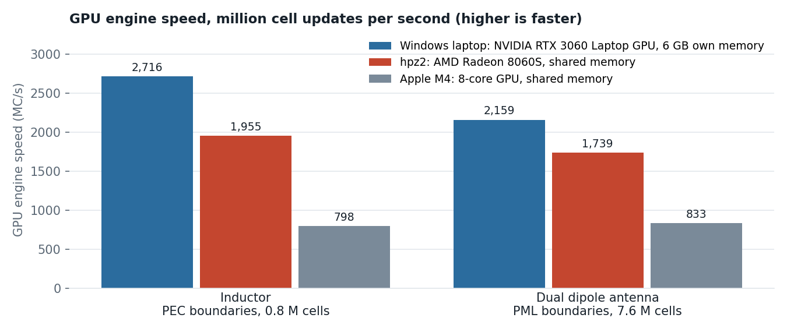
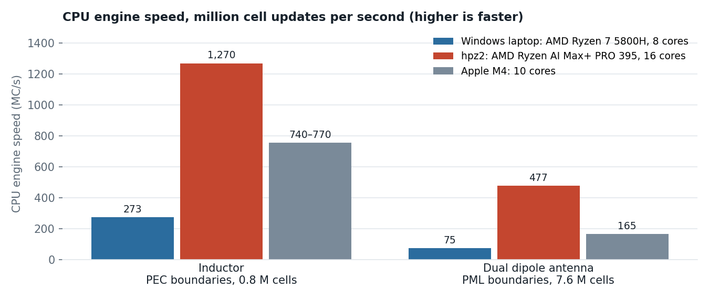

# Running openEMS on the GPU

## Why a GPU?

openEMS is an FDTD solver. In every timestep it updates the fields in every mesh cell, so the run time grows with the number of cells times the number of timesteps. Antennas, mm-wave structures and anything with a large air box quickly reach millions of cells and hundreds of thousands of timesteps, and the simulation then takes from many minutes to hours.

Each cell update is simple arithmetic on a few numbers, and all cells can be updated at the same time. That is what GPUs are built for: thousands of small cores working on large arrays in parallel.

## What is new

openEMS now has a GPU engine. It runs on Apple GPUs (Metal, macOS), AMD GPUs (HIP/ROCm) and NVIDIA GPUs (CUDA). The tests below cover all three. The GPU engine is not in an openEMS release yet: you have to build openEMS from its current source code. For Windows, the openEMS project has a test package with the GPU engine. See [Running on the GPU](../../doc/userguide_md_format/Using_OpenEMS_Python_with_IHP_SG13G2_v3.md#running-on-the-gpu) in the user's guide.

In the gds2openEMS model script, one line switches to the GPU:

```python
settings['engine'] = 'gpu'
```

Without this line, openEMS uses its CPU engine as before. Nothing else in the model changes.

## What to expect

The tests ran on three machines with very different GPUs:

| Machine | CPU | GPU | GPU memory |
|---|---|---|---|
| Windows laptop, Windows 11 | AMD Ryzen 7 5800H, 8 cores | NVIDIA GeForce RTX 3060 Laptop GPU, discrete | 6 GB, its own |
| hpz2, Linux | AMD Ryzen AI Max+ PRO 395, 16 cores | AMD Radeon 8060S, built into the processor | shared with the CPU, 107 GB |
| Apple M4 MacBook Air, macOS | 10 cores | 8-core GPU, built into the processor | shared with the CPU, 16 GB |



**The type of GPU matters most.** The laptop's discrete NVIDIA GPU was the fastest for both models, 1.2× to 1.4× faster than hpz2's GPU and about 3× faster than the M4's.



**The CPU engines differ just as much.** hpz2's CPU was the fastest, the laptop's the slowest, especially with PML boundaries: 75 MC/s for the dual dipole, against 273 MC/s for the inductor with PEC boundaries. For the laptop's dual dipole, the chart shows the speed after it had settled; that run was stopped early.

**The speedup over the CPU of the same machine** therefore depends on both, and on the boundaries:

| Model | Windows laptop | hpz2 | Apple M4 |
|---|---|---|---|
| Inductor, PEC boundaries, 0.8 M cells | **8.6×** | 1.6× | 1.05× |
| Dual dipole antenna, PML boundaries, 7.6 M cells | **about 29×** (estimated) | 3.6× | 4.9× |
| Dual dipole antenna, MUR boundaries, 7.6 M cells | about 10× (estimated) | 2.6× | 2.1× |
| Thru line, PML boundaries, 0.36 M cells | **14×** | 3.3× | 3.5× |
| GSG thru line, PEC and MUR boundaries, 2.2 M cells | 3.8× | 1.9× | 1.2× |

- On the laptop, the dual dipole takes 11.6 minutes on the GPU. On its CPU, it would take about 5.5 hours. The estimated values come from the engine speeds of runs that were stopped once their speed had settled.
- The GSG thru line is a short run: preparing the model, which the GPU does not speed up, limits the gain.
- With a GPU built into the processor, the gain is largest for models with PML boundaries, where the CPU engine is slow. With PEC boundaries, these GPUs gain little.
- **The results agree** on all machines and with both engines. The small differences come from runs stopping at slightly different timesteps.

## Discrete GPU or shared memory?

The GPUs in hpz2 and in the Apple M4 are built into the processor. They have no memory of their own and use the computer's main memory, shared with the CPU. A discrete GPU, like the NVIDIA RTX 3060 in the Windows laptop, is a separate chip with its own graphics memory. That memory is faster, but its size is fixed.

### Speed

FDTD does little arithmetic per cell but reads and writes many field values in every timestep. How fast the GPU can access its memory therefore matters a lot, and a discrete GPU's own memory is faster.

- The laptop's discrete GPU was 1.4× faster than hpz2's GPU for the inductor and 1.2× for the dual dipole antenna, and 2.6× to 3.4× faster than the M4's GPU.
- For the dual dipole, the laptop GPU slowed down during the run, from about 2,270 to as low as 1,800 MC/s, at 87 °C. In this long run, the laptop's cooling probably limited its GPU.

### Model size

On a discrete GPU, the whole model must fit into its own graphics memory.

- The dual dipole antenna (7.6 M cells, PML boundaries) used about 0.64 GB of GPU memory, roughly 90 bytes per cell.
- The RTX 3060 Laptop GPU has 6 GB, but Windows and the programs that were open used 3.9 GB of it during the test. The remaining 2 GB fit about 20 to 25 M cells. Even with the whole 6 GB free, the limit would be roughly 65 M cells.
- On hpz2 (107 GB) and the M4 (16 GB), the GPU uses the main memory, so much larger models fit there, as with the CPU engine.

openEMS prints the model size at the start of a run, e.g. `FDTD simulation size: 259x259x113 --> 7.58015e+06 FDTD cells`. Compare that with the free graphics memory before running a large model on a discrete GPU. What happens when a model does not fit was not tested here.

## Test models

Each folder has the GDSII file, the stackup, the model scripts for CPU and GPU, and a README with the details for each machine. The thru lines are the workflow examples `run_line_full2port.py` and `run_line_GSG_complex.py`.

| Folder | Model |
|---|---|
| [`dual_dipole`](dual_dipole) | Dual dipole antenna at 245 GHz, with PML and with MUR boundaries |
| [`ind500p`](ind500p) | Octagon inductor with center tap, 0–100 GHz |
| [`line_full2port`](line_full2port) | Thru line with PML boundaries, full 2-port, 20–100 GHz (tested on Apple M4) |
| [`line_GSG`](line_GSG) | GSG thru line with composite ports, 0–350 GHz (tested on Apple M4) |
