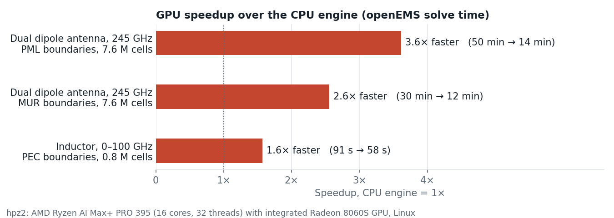
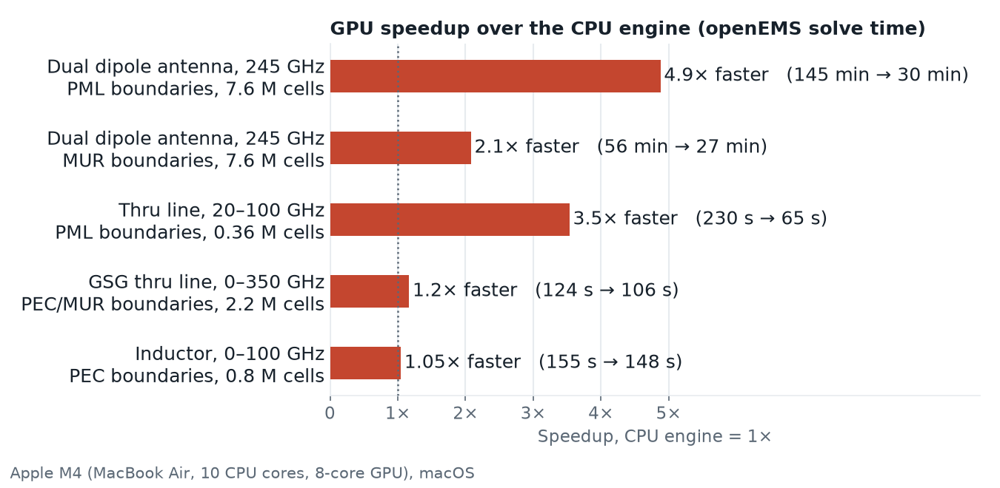

# Running openEMS on the GPU

## Why a GPU?

openEMS is an FDTD solver. In every timestep it updates the fields in every mesh cell, so the run time grows with the number of cells times the number of timesteps. Antennas, mm-wave structures and anything with a large air box quickly reach millions of cells and hundreds of thousands of timesteps, and the simulation then takes from many minutes to hours.

Each cell update is simple arithmetic on a few numbers, and all cells can be updated at the same time. That is what GPUs are built for: thousands of small cores working on large arrays in parallel.

## What is new

openEMS now has a GPU engine. It runs on Apple GPUs (Metal, macOS), AMD GPUs (HIP/ROCm) and NVIDIA GPUs (CUDA). The tests below cover AMD and Apple; NVIDIA was not tested here. The GPU engine is not in an openEMS release yet: you have to build openEMS from its current source code. See [Running on the GPU](../../doc/userguide_md_format/Using_OpenEMS_Python_with_IHP_SG13G2_v3.md#running-on-the-gpu) in the user's guide.

In the gds2openEMS model script, one line switches to the GPU:

```python
settings['engine'] = 'gpu'
```

Without this line, openEMS uses its CPU engine as before. Nothing else in the model changes.

## What speedup to expect

### hpz2: AMD Ryzen AI Max+ PRO 395 (16 cores, 32 threads), integrated Radeon 8060S GPU, Linux



- The GPU engine was 1.6× to 3.6× faster than the CPU engine on the same machine.
- The gain is largest for big models with PML boundaries, where the CPU engine is slow.
- Small models with simple PEC boundaries gain less.
- The S-parameters and antenna results agree between CPU and GPU. Changing the boundary type changes the results much more than changing the engine.

### Apple M4 (MacBook Air, 10 CPU cores, 8-core GPU), macOS



- The GPU engine was 1.05× to 4.9× faster than the CPU engine on the same machine.
- The gain is largest for big models with PML boundaries: 4.9× for the dual dipole, 145 minutes on the CPU against 30 minutes on the GPU. Even the small thru line with PML was 3.5× faster. With PML, the CPU engine is slow.
- Without PML, the gain is smaller: 2.1× for the dual dipole with MUR. With PEC boundaries, the M4's CPU engine runs at about the same speed as its GPU: the inductor was only 1.05× faster on the GPU, against 1.6× on hpz2.
- For the GSG thru line (1.2×), the timesteps were 1.5× faster on the GPU, but openEMS sets up the model on the CPU for both engines, and in this short run the setup took a large part of the time.
- The S-parameters, the antenna results and the inductor's L and Q agree between CPU and GPU.
- Compared to hpz2, the M4's GPU is about half as fast and its CPU engine about a third as fast. The GPU therefore gains more with PML on the M4 (4.9× against 3.6× for the dual dipole), but less without PML.
- The thru lines are the workflow examples `run_line_full2port.py` and `run_line_GSG_complex.py`.

## Test models

Each folder has the GDSII file, the stackup, the model scripts for CPU and GPU, and a README with the details:

| Folder | Model |
|---|---|
| [`dual_dipole`](dual_dipole) | Dual dipole antenna at 245 GHz, with PML and with MUR boundaries |
| [`ind500p`](ind500p) | Octagon inductor with center tap, 0–100 GHz |
| [`line_full2port`](line_full2port) | Thru line with PML boundaries, full 2-port, 20–100 GHz (tested on Apple M4) |
| [`line_GSG`](line_GSG) | GSG thru line with composite ports, 0–350 GHz (tested on Apple M4) |
