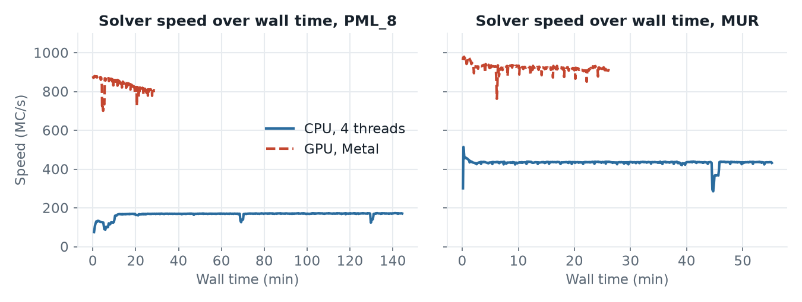
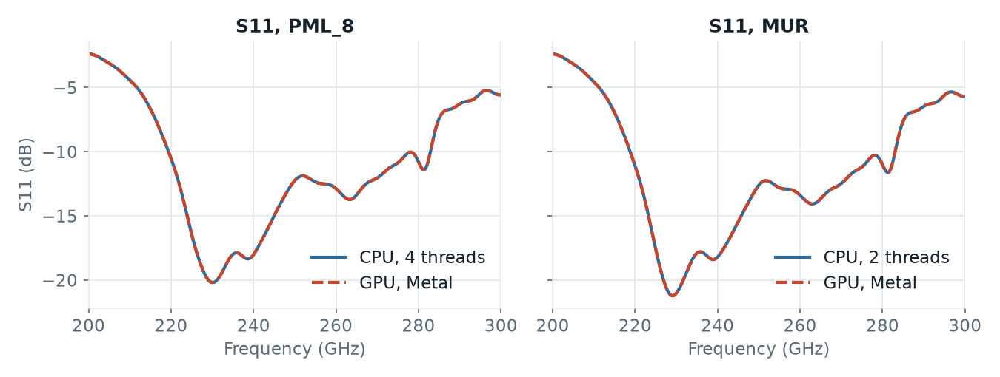

# Dual dipole antenna: CPU vs GPU

A 245 GHz dual dipole antenna on IHP SG13G2 (IHP design, K. Schmalz). The model has 7.6 M mesh cells. It computes S11 from 200 to 300 GHz and the radiation pattern at 245 GHz, with PML or with MUR absorbing boundaries.

## Key facts

- With PML boundaries, the GPU was **3.6× to 4.9× faster** on the machines with a GPU built into the processor, and **about 29× faster** on the Windows laptop with its discrete NVIDIA GPU.
- With MUR boundaries, the gain is smaller (2× to 10×), because the CPU engine is much faster with MUR.
- CPU and GPU give the same S11 and the same antenna results.
- PML or MUR changes the result far more than CPU or GPU.

## Speed

Solve time with PML boundaries:

| Machine | CPU engine | GPU engine | GPU speedup |
|---|---|---|---|
| hpz2, Radeon 8060S | 50 min | 14 min | 3.6× |
| Apple M4 | 145 min | 30 min | 4.9× |
| Windows laptop, RTX 3060 | about 5.5 h (estimated) | 12 min | about 29× |


- The GPU engine runs at a steady speed from the start.
- PML boundaries are slow on the CPU engine. That is where the GPU gains most.
- The laptop's CPU engine is the slowest of the three, and its GPU the fastest, so the gap is largest there. Its CPU run was stopped once its speed had settled; the 5.5 hours are calculated from that speed.

With MUR boundaries:

| Machine | CPU engine | GPU engine | GPU speedup |
|---|---|---|---|
| hpz2 | 30 min | 12 min | 2.6× |
| Apple M4 | 56 min | 27 min | 2.1× |
| Windows laptop | about 1.5 h (estimated) | about 9 min (estimated) | about 10× |

MUR needs much less computation than PML. The CPU engine profits a lot from that, the GPU engine less. On the laptop, both MUR runs were stopped once their speed had settled; the times are calculated from that speed and about 195,000 timesteps, as on hpz2.

## Results


The S11 curves of CPU and GPU lie on top of each other, on every machine. The antenna results agree too: about 8.1 dBi directivity and 77.5 % radiation efficiency at 245 GHz.

The tiny differences (a few hundredths of a dB) come from where each run stops. The GPU engine checks the end criterion at other timesteps than the CPU engine.

Per timestep, both engines converge the same way: the energy in the model decays identically, the GPU just gets there sooner (see [more plots](#more-plots)).

## PML or MUR?


The boundary type changes S11 by up to 1.6 dB, about 40 times the CPU/GPU difference. With MUR, the directivity is also 0.36 dB higher.

MUR is a simpler absorbing boundary and reflects part of the radiated wave back into the model. PML is the better choice for antennas. With the GPU engine, it costs little extra time: 14 minutes instead of 12 on hpz2.

## Model and scripts

| Script | Engine | Boundaries |
|---|---|---|
| [`openEMS_dual_dipole_pml_cpu.py`](openEMS_dual_dipole_pml_cpu.py) | CPU (default) | `PML_8` |
| [`openEMS_dual_dipole_pml_gpu.py`](openEMS_dual_dipole_pml_gpu.py) | GPU | `PML_8` |
| [`openEMS_dual_dipole_mur_cpu.py`](openEMS_dual_dipole_mur_cpu.py) | CPU (default) | `MUR` |
| [`openEMS_dual_dipole_mur_gpu.py`](openEMS_dual_dipole_mur_gpu.py) | GPU | `MUR` |

The scripts differ only in these two settings:

```python
settings['engine'] = 'gpu'                  # GPU scripts only
settings['Boundaries'] = ['PML_8'] * 6      # or ['MUR'] * 6
```

All four set `settings['resonance_estimation'] = False`, so every run continues to the −40 dB end criterion and the run times are comparable. The model files are `dipole_port_sg13.gds` and the stackup `SG13G2_200um_backsideGND.xml`.

## Test details

| | hpz2 | Apple M4 | Windows laptop |
|---|---|---|---|
| CPU | AMD Ryzen AI Max+ PRO 395, 16 cores | Apple M4, 10 cores | AMD Ryzen 7 5800H, 8 cores |
| GPU | AMD Radeon 8060S, built-in, HIP | Apple M4, 8 cores, built-in, Metal | NVIDIA RTX 3060 Laptop, 6 GB, HIP |
| Main memory, OS | 107 GB, Linux | 16 GB, macOS | 32 GB, Windows 11 |
| openEMS | v0.37.0-33-g53a4264 | v0.37.0-32-gec4d2db | v0.37.0-38-gd686f1d (Windows test package) |
| gds2openEMS | 0.6.3 | 0.6.3 | 0.6.4 |
| CPU threads (automatic) | 32 | 4 (PML), 2 (MUR) | not recorded |
| GPU speed, PML | 1,739 MC/s | 833 MC/s | 2,159 MC/s |
| CPU speed, PML | 477 MC/s | 165 MC/s | 75 MC/s (settled, run stopped) |
| GPU speed, MUR | 2,124 MC/s | 922 MC/s | 2,750 MC/s (settled, run stopped) |
| CPU speed, MUR | 793 MC/s | 433 MC/s | 278 MC/s (settled, run stopped) |
| Timesteps, PML (CPU / GPU) | 189,001 / 190,656 | 189,001 / 190,656 | – / 198,269 |

All machines: mesh 259 × 259 × 113 = 7.58 M cells, smallest cell 2.07 × 2.50 × 0.40 µm, Gaussian pulse 200–300 GHz, timestep 1.26 fs, end criterion −40 dB. The runs on each machine ran one after another.

GPU memory: the model used about 0.64 GB on the laptop's GPU. See [Discrete GPU or shared memory?](../README.md#discrete-gpu-or-shared-memory) for what that means for larger models.

## More plots

Energy decay per timestep and over wall time, PML, hpz2:


Solver speed and S11 with MUR, hpz2:


Solver speed and S11 on the Apple M4. The MacBook Air has no fan; the GPU speed fell slowly from 875 to about 805 MC/s during the PML run.




