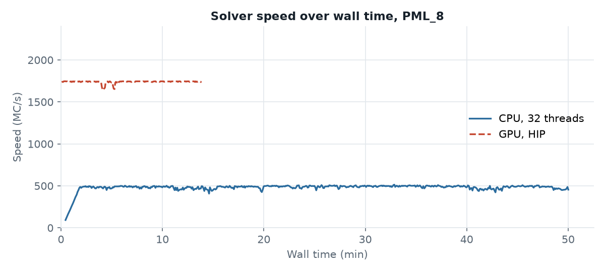
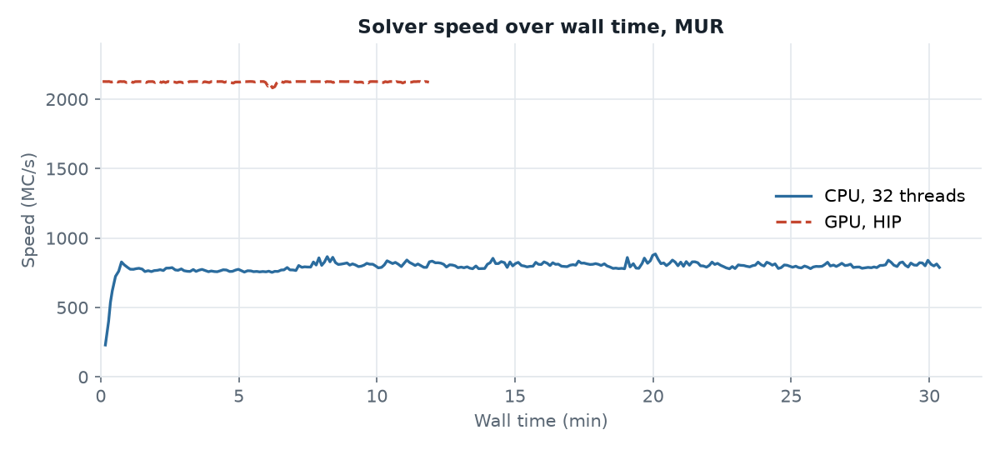
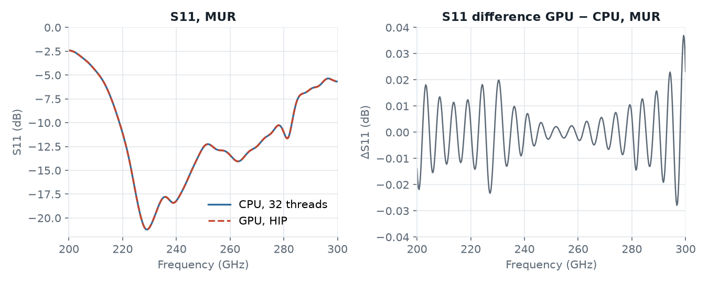

# Dual dipole antenna: CPU vs GPU

A 245 GHz dual dipole antenna on IHP SG13G2 (IHP design, K. Schmalz), `dipole_port_sg13.gds` with stackup `SG13G2_200um_backsideGND.xml`. The model has 7.6 M mesh cells and computes S11 from 200 to 300 GHz, plus the radiation pattern at 245 GHz.

It was simulated four times: with the CPU and the GPU engine, each with PML and with MUR absorbing boundaries.

| Script | Engine | Boundaries |
|---|---|---|
| [`openEMS_dual_dipole_pml_cpu.py`](openEMS_dual_dipole_pml_cpu.py) | CPU (default) | `PML_8` |
| [`openEMS_dual_dipole_pml_gpu.py`](openEMS_dual_dipole_pml_gpu.py) | GPU | `PML_8` |
| [`openEMS_dual_dipole_mur_cpu.py`](openEMS_dual_dipole_mur_cpu.py) | CPU (default) | `MUR` |
| [`openEMS_dual_dipole_mur_gpu.py`](openEMS_dual_dipole_mur_gpu.py) | GPU | `MUR` |

The scripts differ only in these two settings:

```python
settings['engine'] = 'gpu'                  # GPU scripts only
settings['Boundaries'] = ['PML_8'] * 6      # or ['MUR'] * 6
```

All four also set `settings['resonance_estimation'] = False`, so every run continues until the energy has decayed to the -40 dB end criterion. That makes the run times comparable.

The runs were on hpz2: AMD Ryzen AI Max+ PRO 395 (16 cores, 32 threads) with integrated Radeon 8060S GPU, Linux. They ran one after another, because the CPU and the integrated GPU share the same memory.

## PML boundaries: 3.6× faster



The GPU engine ran at a steady 1,740 million cell updates per second (MC/s). The CPU engine ran at about 480 MC/s. The simulation took 14 minutes on the GPU and 50 minutes on the CPU.

### Same convergence


Per timestep, the energy in the model decays the same way with both engines (left). The GPU only gets there sooner (right). Most of the run time is spent in the slow tail after the excitation, typical for a resonant structure like this antenna.

### Same results


The S11 curves lie on top of each other. The largest difference is 0.02 dB. It comes from the two runs stopping at slightly different timesteps: the GPU engine checks the end criterion less often. The antenna results at 245 GHz agree as well:

| At 245 GHz | CPU | GPU |
|---|---|---|
| Directivity | 8.09 dBi | 8.09 dBi |
| Radiation efficiency | 77.54 % | 77.55 % |

## MUR boundaries: 2.6× faster



MUR boundaries need much less computation than PML. This helps the CPU engine a lot: it runs 66 % faster with MUR than with PML. The GPU engine gains only 22 %. So with MUR the GPU advantage drops to 2.6×: 12 minutes on the GPU, 30 minutes on the CPU.



Again, CPU and GPU give the same S11, within 0.04 dB.

## PML or MUR?


The boundary type changes the result far more than the engine does. With MUR, the S11 minimum is 1 dB deeper and the curves differ by up to 1.6 dB, about 40 times the CPU/GPU difference. The directivity at 245 GHz is 0.36 dB higher with MUR.

MUR is a simpler absorbing boundary and reflects part of the radiated wave back into the model. PML is the better reference for antennas. With the GPU engine, PML costs little extra time: 14 minutes with PML, 12 minutes with MUR.

## Test details

| Item | Value |
|---|---|
| Mesh | 259 × 259 × 113 = 7.58 M cells, smallest cell 2.07 × 2.50 × 0.40 µm |
| Excitation | Gaussian pulse 200–300 GHz, timestep 1.26 fs |
| End criterion | `energy_limit = -40` dB, about 190,000 timesteps |
| openEMS | v0.37.0-33-g53a4264 (built from source, with GPU engine) |
| gds2openEMS | 0.6.3 |
| CPU engine | 32 threads (automatic thread count) |
| GPU engine | HIP backend, Radeon 8060S (integrated) |
| Host | hpz2: AMD Ryzen AI Max+ PRO 395 (16 cores, 32 threads), 107 GB RAM, Linux |
