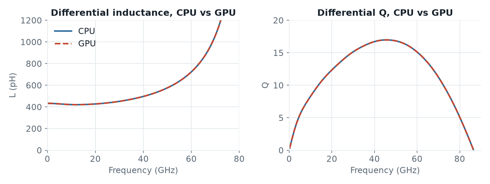

# Inductor: CPU vs GPU

An octagon inductor with center tap (`OctaDiffTap_0n50_ports.gds`, stackup `SG13G2_200um.xml`), simulated from 0 to 100 GHz with two via ports from Metal1 to TopMetal2. The model has 0.8 M mesh cells and PEC boundaries, and runs one excitation per port.

| Script | Engine |
|---|---|
| [`openEMS_500pH_cpu.py`](openEMS_500pH_cpu.py) | CPU (default) |
| [`openEMS_500pH_gpu.py`](openEMS_500pH_gpu.py) | GPU: `settings['engine'] = 'gpu'` |

That one line is the only difference between the two scripts.

## Speed

On hpz2 (AMD Ryzen AI Max+ PRO 395 with 16 cores and 32 threads, integrated Radeon 8060S GPU, Linux), the GPU engine solved each excitation in 29 s, the CPU engine in 45 s. The GPU was 1.6× faster.

That is less than for the [dual dipole](../dual_dipole) (3.6×). This model is about ten times smaller and has PEC boundaries.

On an Apple M4 (MacBook Air, 10 CPU cores, 8-core GPU, macOS), the GPU engine solved the two excitations in 75 s and 73 s, the CPU engine in 77 s and 78 s. The GPU was only 1.05× faster. Both engines ran at about the same speed: the GPU engine at 798 MC/s, the CPU engine at 740–770 MC/s with 3 or 4 threads. With PEC boundaries, the M4's CPU engine is fast; with PML boundaries it drops to about 170 MC/s, see the [thru line with PML](../line_full2port), where the GPU was 3.5× faster. On the M4, the CPU and the GPU also share the same memory, whose speed probably limits both here.

## Results

On hpz2, both engines give identical results. The port voltages and currents from openEMS match to the last digit, and so do the S-parameters. Both runs give 433 pH at 1 GHz, a peak Q of 17 at 45 GHz, and self-resonance at 87 GHz.

On the Apple M4, CPU and GPU give the same values as on hpz2: 433 pH at 1 GHz, a peak Q of 17 at 45 GHz, and self-resonance at 87 GHz. Here the two engines differ very slightly, by at most 0.09 pH in L and 0.003 in Q below 70 GHz, because the runs stopped at slightly different timesteps (CPU 70,798 and 70,020, GPU 71,576 and 70,020). For the M4 runs, `no_gui = True` and `force_simulation = True` were set, for a batch run; openEMS v0.37.0-32-gec4d2db, each engine ran once.
