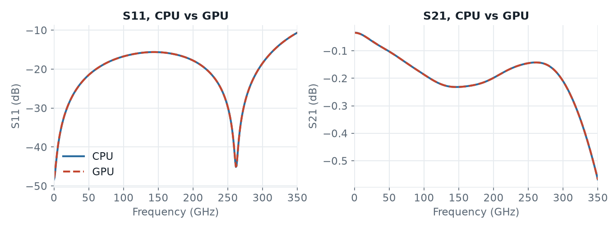

# GSG thru line: CPU vs GPU

A 50 Ω GSG thru line, simulated from 0 to 350 GHz. This is the workflow example [`run_line_GSG_complex.py`](../../../workflow/run_line_GSG_complex.py). The model has 2.2 M mesh cells, PEC boundaries and a MUR boundary at the top.

## Key facts

- The GPU was **1.9× faster** on hpz2, only **1.2× faster** on the Apple M4 and **3.8× faster** on the Windows laptop.
- The timesteps themselves were 2.3× (hpz2), 1.5× (M4) and 10× (laptop) faster on the GPU. But openEMS prepares the model on the CPU for both engines, and in this short run that preparation took a large part of the time.
- CPU and GPU give the same S-parameters.

## Speed

| Machine | CPU engine | GPU engine | GPU speedup |
|---|---|---|---|
| hpz2, Radeon 8060S | 71 s | 37 s | 1.9× |
| Apple M4 | 124 s | 106 s | 1.2× |
| Windows laptop, RTX 3060 | 249 s | 66 s | 3.8× |

Where the time went:

| | hpz2, CPU | hpz2, GPU | M4, CPU | M4, GPU | Laptop, CPU | Laptop, GPU |
|---|---|---|---|---|---|---|
| Model preparation | 11 s | 12 s | 36 s | 48 s | 45 s | 46 s |
| Timesteps | 60 s | 25 s | 88 s | 58 s | 204 s | 20 s |

- On hpz2 and the M4, the CPU engine is fast without PML, so the timesteps gain only 2.3× and 1.5×.
- hpz2 prepares the model much faster than the other two machines.
- On the laptop, the timesteps are 10× faster on the GPU. But then the preparation takes more than two thirds of the GPU run.
- The preparation is not faster with the GPU engine. In a short run like this, it limits the overall gain.
- Compare the [thru line with PML](../line_full2port): there the GPU was 3.5× faster.

## Results

The curves of CPU and GPU lie on top of each other (Apple M4 shown). S21 agrees within 0.001 dB, S11 within 0.03 dB in the useful range. On hpz2, CPU and GPU gave identical S-parameters, the same as the laptop's GPU. The laptop's CPU run stopped at a slightly different timestep and agrees within 0.001 dB in S21.

Only at the lowest S11, −48 dB near DC, is the difference larger, 0.5 dB. It comes from where each run stops: the GPU engine checks the end criterion at other timesteps than the CPU engine.

## Model and scripts

| Script | Engine |
|---|---|
| [`openEMS_line_GSG_cpu.py`](openEMS_line_GSG_cpu.py) | CPU (default) |
| [`openEMS_line_GSG_gpu.py`](openEMS_line_GSG_gpu.py) | GPU: `settings['engine'] = 'gpu'` |

That one line is the only difference between the two scripts. Compared to the workflow example, both also set `preview_only = False`, `no_gui = True` and `force_simulation = True` for a batch run. The model files are `gsg_through_50ohm.gds` and the stackup `SG13G2.xml`. Each GSG port is made from two in-plane ports of 100 Ω, from the signal line to the ground on either side, both excited at the same time. The model runs one excitation; the reverse direction comes from symmetry.

## Test details

| | hpz2 | Apple M4 | Windows laptop |
|---|---|---|---|
| CPU | AMD Ryzen AI Max+ PRO 395, 16 cores | Apple M4, 10 cores (4 performance, 6 efficiency) | AMD Ryzen 7 5800H, 8 cores |
| GPU | AMD Radeon 8060S, built-in, HIP | Apple M4, 8 cores, built-in, Metal | NVIDIA RTX 3060 Laptop, 6 GB, HIP |
| Main memory, OS | 107 GB, Linux | 16 GB, macOS 26 | 32 GB, Windows 11 |
| openEMS | v0.37.0-33-g53a4264 | v0.37.0-32-gec4d2db | v0.37.0-38-gd686f1d (Windows test package) |
| GPU speed | 2,272 MC/s | 995 MC/s | 2,902 MC/s |
| CPU speed | 969 MC/s (8 threads, automatic) | 670 MC/s (4 threads, automatic) | 287 MC/s (automatic threads) |
| Timesteps (CPU / GPU) | 26,620 / 26,620 | 27,224 / 26,620 | 26,892 / 26,620 |

All machines: mesh 154 × 166 × 85 = 2.17 M cells, smallest cell 1.21 × 1.25 × 0.40 µm, Gaussian pulse 0–350 GHz, timestep 1.07 fs, end criterion −40 dB. Each engine ran once, one after the other. The preparation time is the openEMS solve time minus the time for the timesteps. The hpz2 and laptop results are not in the repository.
