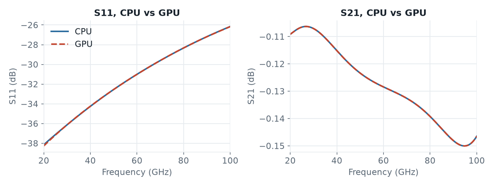

# Thru line, full 2-port: CPU vs GPU

A thru line on TopMetal2 (`line_simple.gds`, stackup `SG13G2_nosub.xml`), simulated from 20 to 100 GHz with two in-plane ports. This is the workflow example [`run_line_full2port.py`](../../../workflow/run_line_full2port.py). The model has 0.36 M mesh cells and `PML_8` boundaries on five sides (PEC below). It runs one excitation per port, so the GPU engine is started twice in the same Python process.

| Script | Engine |
|---|---|
| [`openEMS_line_full2port_cpu.py`](openEMS_line_full2port_cpu.py) | CPU (default) |
| [`openEMS_line_full2port_gpu.py`](openEMS_line_full2port_gpu.py) | GPU: `settings['engine'] = 'gpu'` |

That one line is the only difference between the two scripts. Compared to the workflow example, both also set `preview_only = False`, `no_gui = True` and `force_simulation = True` for a batch run.

## Speed

On an Apple M4 (MacBook Air, 10 CPU cores, 8-core GPU, macOS), the GPU engine solved the two excitations in 32 s and 33 s, the CPU engine in 112 s and 118 s. The GPU was 3.5× faster.

The GPU engine ran at a steady 640 million cell updates per second (MC/s), the CPU engine at 160–175 MC/s. The CPU engine chose 4 threads by itself, the M4's performance cores.

The gain is large although the model is small, because of the PML boundaries: they are slow on the CPU engine, and the GPU engine updates them together with the rest of the model.

## Results

The curves lie on top of each other. The transmission (S21, S12) agrees within 0.015 dB, the reflection (S11, S22) within 0.02 dB above −30 dB, and within 0.12 dB at the lowest S11 of −38 dB. The differences come from the runs stopping at slightly different timesteps (CPU 52,629 and 51,636, GPU 51,662 for both): the GPU engine checks the end criterion at other timesteps.

## Test details

| Item | Value |
|---|---|
| Mesh | 112 × 89 × 36 = 0.36 M cells, smallest cell 1.44 × 1.25 × 0.40 µm |
| Excitation | Gaussian pulse 20–100 GHz, timestep 1.26 fs |
| End criterion | `energy_limit = -40` dB, about 52,000 timesteps per excitation |
| openEMS | v0.37.0-32-gec4d2db (built from source, with GPU engine) |
| gds2openEMS | 0.6.3 |
| CPU engine | 4 threads (automatic thread count) |
| GPU engine | Metal backend, Apple M4 (integrated, 8 cores) |
| Host | Apple M4 MacBook Air (4 performance and 6 efficiency cores), 16 GB RAM, macOS 26 |

Each engine ran once, one after the other. The MacBook Air has no fan, so long runs can be slowed down by thermal throttling.
