# L6n2 inductor with openEMS vs. measurement (IHP SG13G2)

This study looks for the most accurate openEMS model of an inductor, compared with measured data. There is a similar study for the gds2palace FEM workflow; some aspects are the same, but there is also **one important model setting specific to the FDTD method** used here.

If you can't wait: the final result, compared with the measurement and with Palace FEM, is at the end of this document.

The study starts with a check of the simulation box, then looks at four possible error sources, one after another:

- **Simulation box:** the model ends at PEC walls. Too close to the coil, they lower L and shift Q and the SRF. The box is chosen first, so that all later steps use it.
- **Via array merging:** merged via arrays have a larger cross section than the single vias, so their resistance comes out too low. A gds2openEMS option corrects that.
- **Energy end criterion:** openEMS stops when the energy left in the model has dropped by a set amount. This turns out to be the critical setting for R and Q at these frequencies, and it is investigated in detail.
- **Mesh size:** with the end criterion set, is the result converged in the mesh?
- **Passivation over TopMetal2:** a planar dielectric over the top metal overestimates the capacitance between the turns. A stackup with the passivation cut between the traces fixes that.

The conductor model, a topic of the FEM study, does not apply here: gds2openEMS always meshes the conductors as volumes with their conductivity.

## Layout and setup

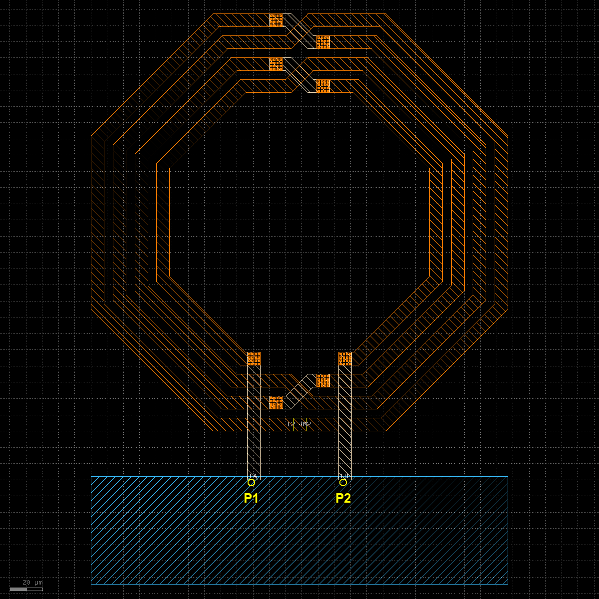

- **Layout:** `L6n2_with_ports.gds`, a 4-turn octagonal spiral on TopMetal2 (8 µm line width), with TopMetal1 underpasses connected through 8 TopVia2 arrays of 4×4 vias.
- **Ports:** via ports P1 and P2 from SUBGND (ideal ground plane) to TopMetal1, at the two leads.
- **Stackups:**
  - `openEMS_SG13G2_200um.xml`: planar, with SiO2 + passivation filling the gaps between the TopMetal2 traces;
  - `openEMS_SG13G2_200um_passicut.xml`: passivation cut, see [the fourth error source](#fourth-error-source-the-passivation-over-topmetal2).
- **Box:** PEC walls, 250 µm margin (the dielectrics beyond the layout) and 800 µm of air beyond that on all six sides, see [the simulation box](#step-0-the-simulation-box).
- **Solver settings:** fstop 14 GHz, 20 cells per wavelength at fstop, and via array merging with `merge_polygon_size = 2`.
- **Mesh:** `refined_cellsize` is the mesh size on the conductors: 2 µm, 1 µm and 0.5 µm.
- **Software and machine:** gds2openEMS 0.7.0 and openEMS built from its source code (1d710c2, November 2026), with its new CPU engine (`settings['engine'] = 'cpu'`, experimental, not in an openEMS release yet). All runs on hpz2, an HP Z2 mini with an AMD Ryzen AI Max+ PRO 395 (16 cores) and 128 GB RAM. Solve times are for both port excitations together.
- **Measurement:** `meas_L5_6n2_THRU_deemb.S2P`, test fixture de-embedded.

All plots show the differential L, Q and R, from Zdiff = Z11 − Z12 − Z21 + Z22, the same calculation as in the gds2palace study. The bottom-right panel zooms in on the low-frequency resistance.

## Step 0: the simulation box

The model ends at PEC walls. A metal wall near the coil carries image currents that push the coil's magnetic field back. That lowers L. The wall also changes the stored electric energy a little, and with it the SRF and Q.

The gds2palace study of this inductor found the same problem with its absorbing boundaries: the boundary must be far away in all directions, also above and below the chip (see its [simulation boundary study](https://github.com/VolkerMuehlhaus/gds2palace_ihp_sg13g2/blob/main/more_examples/simulation_boundary/README.md)).

The test uses the final model of this study (passivation cut, via merge + correction, 1 µm mesh, −60 dB, see the steps below). The `margin` stays at 250 µm, and `air_around` adds air on all six sides. `run_L6n2_mergecorrection_passicut_boundary.py` runs all cases.

| Air around | L @ 1 GHz | Peak Q | SRF | Cells | Solve time |
|---|---|---|---|---|---|
| 0 | 4.812 nH | 14.57 | 11.08 GHz | 1.40 M | 291 s |
| 100 µm | +1.11 % | −0.08 % | −0.74 % | 1.48 M | 355 s |
| 200 µm | +1.42 % | +0.71 % | −0.64 % | 1.53 M | 364 s |
| 400 µm | +1.66 % | +0.34 % | −0.93 % | 1.67 M | 390 s |
| **800 µm** | **+1.82 %** | **+0.74 %** | **−0.88 %** | **2.02 M** | **440 s** |
| 1600 µm | +1.82 % | +0.89 % | −0.82 % | 2.48 M | 593 s |
| 750 µm wafer on the chuck, 800 µm air (not below) | +1.90 % | +0.64 % | −0.89 % | | 421 s |

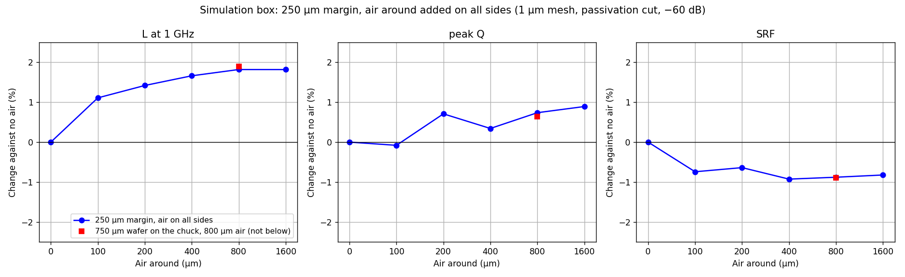

- **L rises by 1.8 % and levels off at 800 µm of air:** 1600 µm gives the same L.
- **The SRF drops by about 0.9 %** and is settled from 400 µm on.
- **Peak Q changes by less than 1 %, and not steadily.** It is read off a 35 MHz frequency grid, and the Q curve is flat near its peak.
- **The real wafer:** the coil was measured on a full 750 µm wafer on a metal chuck. A model with a 750 µm substrate and the PEC wall directly below it as the chuck gives the same result within 0.1 % (`openEMS_SG13G2_750um_passicut.xml`, only the substrate is thicker).
- **The low-frequency resistance does not change** (4.71 Ω at 0.1 GHz in all cases).
- **The cost is moderate:** the added air is meshed coarsely, 800 µm of air adds 44 % cells and 51 % solve time.

All following steps use the 250 µm margin with 800 µm of air.

## First error source: via array merging, solved by fill factor correction

The effect of via array merging was investigated for this inductor because it has several via arrays, and the 8 µm line width allows only small arrays of 4×4 vias.

With 8 via arrays of 16 vias each, the vias add 8/16 × 1.1 Ω = 0.55 Ω nominal resistance. Via array merging replaces the individual vias by their bounding box, roughly a 4× larger cross section. We expect a difference of about 0.4 Ω. That sounds small, but it is about 10 % of the inductor's DC resistance.

`settings['fill_factor_correction'] = True` scales the conductivity of each merged block by its fill factor (original via area / merged area), which is 0.28 here.

Two runs are compared, with and without the correction. Both use the planar stackup, a 1 µm mesh and the default end criterion of −40 dB:

| Model | R @ 0.1 GHz | R @ 1 GHz | L @ 1 GHz | Peak Q | SRF | Solve time |
|---|---|---|---|---|---|---|
| Measured | 4.55 Ω | 4.86 Ω | 5.01 nH | 15.96 @ 4.71 GHz | 11.07 GHz | |
| Via merge, no correction | 3.27 Ω | 4.17 Ω | 5.04 nH | 14.75 @ 4.90 GHz | 9.85 GHz | 197 s |
| Via merge + correction | 3.79 Ω | 4.66 Ω | 5.03 nH | 14.07 @ 4.87 GHz | 9.85 GHz | 193 s |

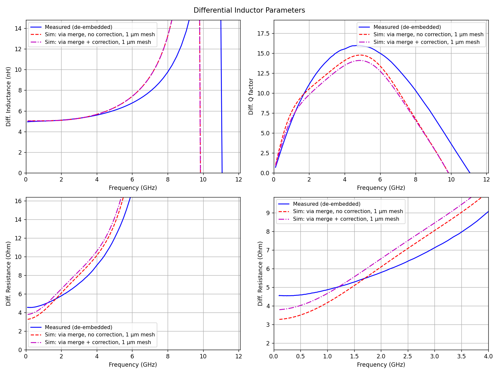

The correction adds 0.52 Ω at 0.1 GHz and 0.49 Ω at 1 GHz, a little more than the 0.40 Ω expected; at −40 dB both runs still carry the error of the end criterion (second error source). But both results are far below the hand calculation and the measurement: 3.79 Ω against about 4.7 Ω. Is it the end criterion, or the mesh? The next two steps check both. Inductance agrees well at low frequency, but the SRF and peak Q are too low (the passivation model, see [the fourth error source](#fourth-error-source-the-passivation-over-topmetal2)).

The strange shape of the Q curve is a side effect of the end criterion, the next step.

## Second error source: the energy end criterion

### Synthetic testcase

openEMS stops the simulation when the energy left in the model has dropped below `settings['energy_limit']`, which was −40 dB in the runs so far.

A synthetic testcase isolates the effect: a straight TopMetal2 line, 8 µm wide, with the same stackup, ports and 0.5 µm mesh, run at −40 dB and at −60 dB. Its resistance is known analytically from the sheet resistance. (This test was run once with an earlier openEMS; its script is not in this folder.)

| Test line | R @ 0.1 GHz | Analytic | Error | L |
|---|---|---|---|---|
| 300 µm, −40 dB | 0.505 Ω | 0.411 Ω | +23% | 161 pH |
| 300 µm, **−60 dB** | 0.412 Ω | 0.411 Ω | +0.2% | 171 pH |
| 600 µm, −40 dB | 1.040 Ω | 0.824 Ω | +26% | 312 pH |
| 600 µm, **−60 dB** | 0.819 Ω | 0.824 Ω | −0.6% | 336 pH |

At −40 dB, R and L at low frequency are off by 6–26 %, and R even falls with frequency. At −60 dB, both are correct. A 45° line gave the same picture (0.475 Ω against 0.411 Ω at −40 dB), so the staircase approximation of diagonal traces is not the cause either.

### Spectral power density of the Gaussian excitation pulse

One idea was the **spectrum of the Gaussian pulse excitation**, which is symmetric around the center frequency: 7 GHz for a 0–14 GHz sweep. The plot below shows that there is enough spectral content down to DC. The power at 0.1 GHz is 13.5 dB below its spectral peak, not an issue for accuracy.

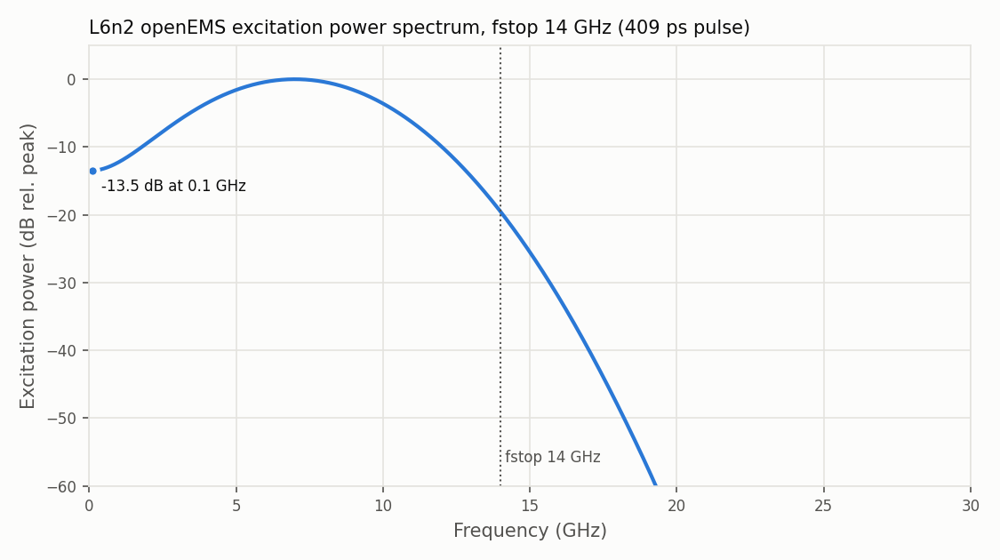

The problem is **not** the spectrum.

### The end criterion, applied to the inductor

```python
settings['energy_limit'] = -40          # end criteria for residual energy (dB)
```

`run_L6n2_mergecorrection_sweep.py` repeats the inductor model at three end criteria, all with the 1 µm mesh, via merge + correction and the planar stackup:

| End criterion | Timesteps | R @ 0.1 GHz | R @ 1 GHz | L @ 1 GHz | Peak Q | SRF | Solve time |
|---|---|---|---|---|---|---|---|
| −40 dB | 339 k | 3.79 Ω | 4.66 Ω | 5.03 nH | 14.07 @ 4.87 GHz | 9.85 GHz | 193 s |
| −50 dB | 433 k | 4.68 Ω | 5.13 Ω | 4.92 nH | 13.86 @ 4.27 GHz | 9.83 GHz | 261 s |
| −60 dB | 714 k | **4.72 Ω** | 5.12 Ω | 4.91 nH | 13.86 @ 4.30 GHz | 9.83 GHz | 409 s |

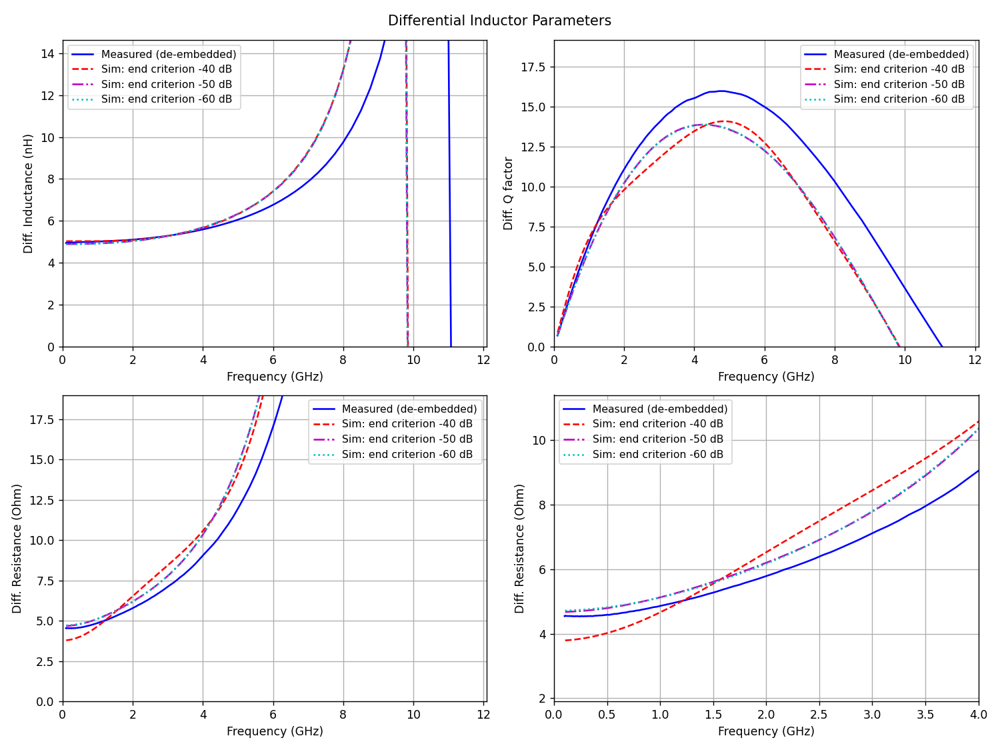

The effect is strong: the strange shape of the Q curve disappears, and the low-frequency resistance changes as well. At −60 dB, it is 4.72 Ω: it matches the DC hand calculation (about 4.7 Ω) and the Palace result (4.69 Ω), and it is close to the measurement (4.55 Ω). The SRF is not affected by the end criterion.

The problem is where the run stops. Below are the time signals, read from the openEMS output files. The time step is 1.24 fs, and the excitation pulse lasts 409 ps (331 k steps). The timesteps in the table are read from the end of the port signals.

- The −40 dB run stops at 420 ps, just after the end of the excitation pulse, while the port 2 voltage is still only 42 dB below its maximum.
- The −50 dB run continues to 536 ps.
- The −60 dB run continues to 884 ps (port 2 at −77 dB).

All three runs are identical up to the point where each one stops; the end criterion only decides how much of the response is recorded before the time signals are transformed to the frequency domain.

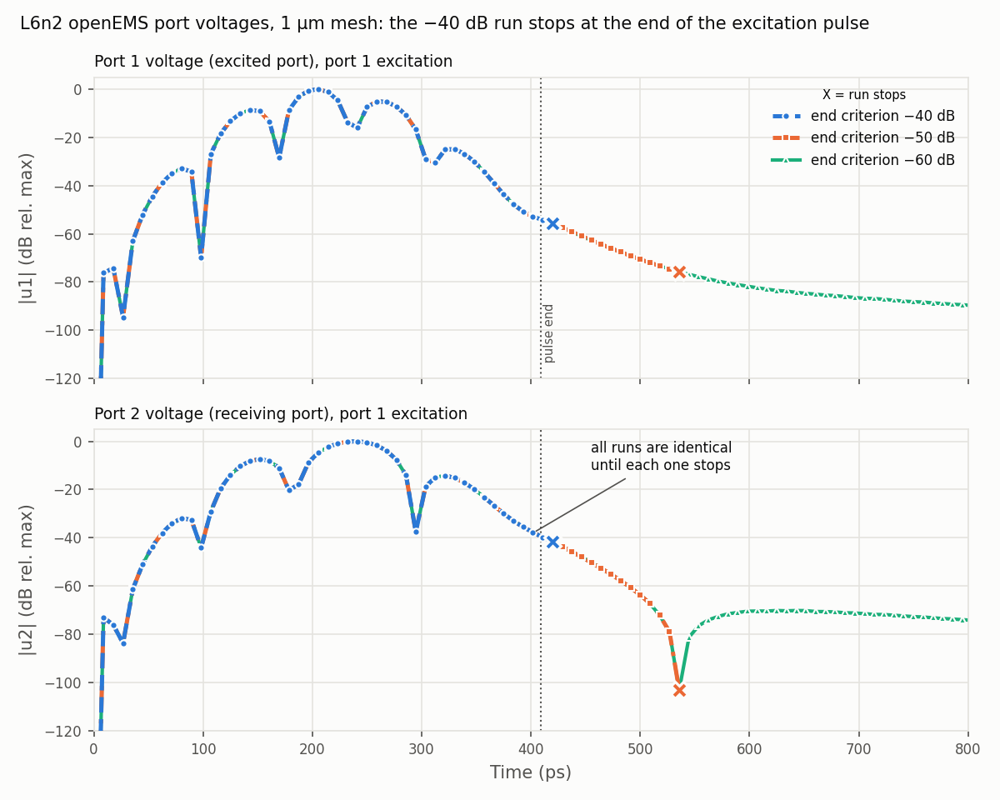

On a linear scale, what the −40 dB run misses is a small exponential tail after the pulse, about 0.04 µV at 420 ps against a peak of about 27 µV. Its fitted time constant is 28–48 ps. That is the order of the coil's L/R time constant with both 50 Ω ports connected: 4.91 nH / (100 Ω + 4.7 Ω) ≈ 47 ps. This tail is the inductor's low-frequency response. The −40 dB run stops just as it begins; the −50 dB run captures most of it, which is why −50 dB is already close to the −60 dB result.

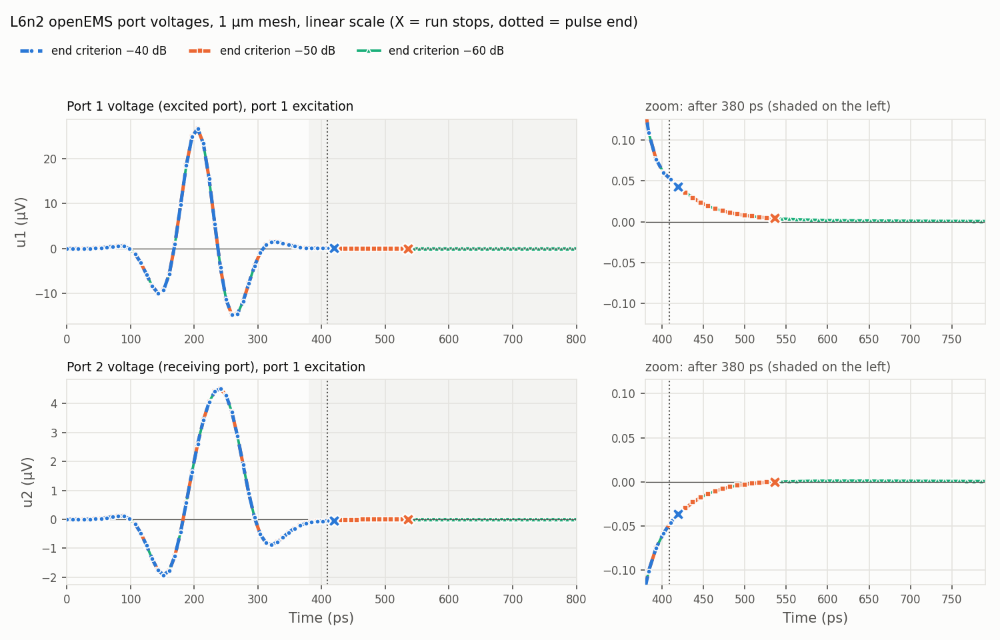

The error from stopping early is not a constant offset but a ripple across frequency. The difference to the −60 dB run oscillates with a period set by how long the run continues after the center of the excitation pulse (205 ps). S-parameters are referenced to the incident pulse, so a run that stops a time t after the pulse center shows a ripple period of about 1/t:

- −40 dB stops 215 ps after the pulse center, so about 4.7 GHz is expected. Its resistance difference crosses zero at 1.5, 4.3 and 6.9 GHz, swinging between −0.9 and +0.7 Ω below 7 GHz.
- −50 dB stops 331 ps after the pulse center, so about 3.0 GHz is expected, with a much smaller amplitude (within ±0.07 Ω below 7 GHz).

The low-frequency end is simply where the −40 dB ripple happens to be at its largest negative value.

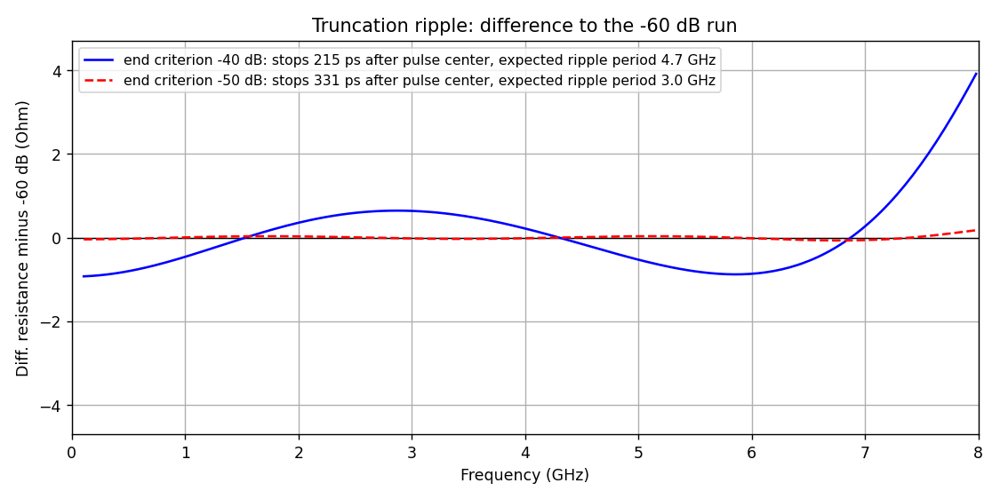

**Conclusion:** for the low-frequency resistance of an inductor, use `settings['energy_limit'] = -60`, or at least −50 dB. On the 1 µm mesh this costs about 2.1× the solve time of −40 dB.

## Third error source? The mesh size

With the end criterion at −60 dB, is the result converged in the mesh? `run_L6n2_mergecorrection_sweep.py` runs the corrected model with a 2 µm and a 1 µm mesh, and `run_L6n2_mergecorrection_mesh0u5.py` with a 0.5 µm mesh. All runs use the planar stackup and −60 dB:

| Mesh (via merge + correction, −60 dB) | R @ 0.1 GHz | L @ 1 GHz | Peak Q | SRF | Cells | Solve time |
|---|---|---|---|---|---|---|
| 2 µm | 4.70 Ω | 4.90 nH | 13.39 @ 4.27 GHz | 9.60 GHz | 0.64 M | 150 s |
| 1 µm | 4.72 Ω | 4.91 nH | 13.86 @ 4.30 GHz | 9.83 GHz | 2.13 M | 409 s |
| 0.5 µm | 4.69 Ω | 4.92 nH | 14.82 @ 4.51 GHz | 10.08 GHz | 8.33 M | 5,661 s |

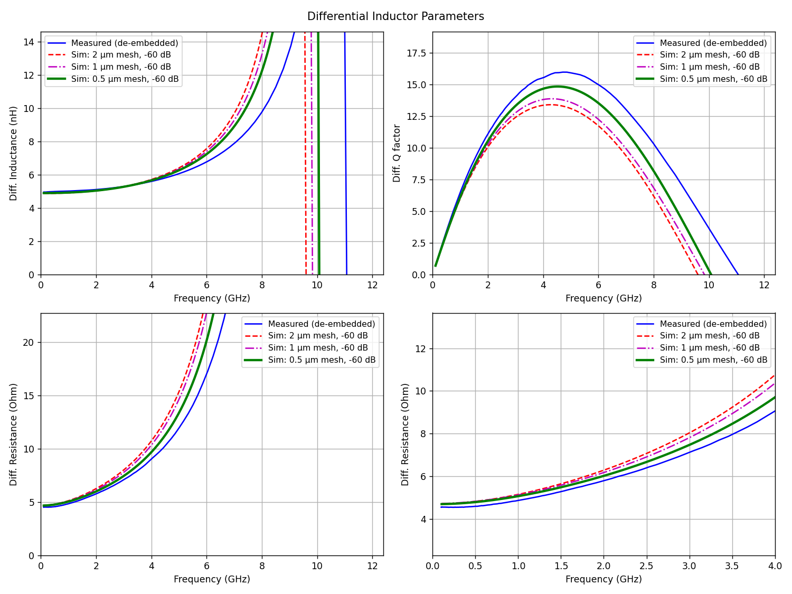

- **R at DC and L are converged:** they change by less than 0.03 Ω and 0.5 % between the meshes. The stackups were also checked: conductor conductivities, thicknesses and the via fill factor are the same as in the Palace model, which gives 4.69 Ω.
- **Peak Q and the SRF are not converged.** From 2 µm to 1 µm, peak Q rises by 3.5 %, from 1 µm to 0.5 µm by 6.9 %. The SRF rises by about 2.5 % with each step.
- **The cause is the loss above about 1 GHz.** At DC, all three meshes give the same resistance. With rising frequency, the current crowds towards the surfaces of the conductors, and a finer mesh resolves that better: at 3 GHz, R is about 8.0, 7.8 and 7.5 Ω (measured: about 7.1 Ω). Less loss means a higher Q.

The next step compares the passivation models at 2 µm and 1 µm, and runs the final model at 0.5 µm as well.

## Fourth error source: the passivation over TopMetal2

With the resistance fixed, the SRF is still too low: 9.8 GHz simulated against 11.07 GHz measured.

The planar stackup fills the gaps between the TopMetal2 traces completely with SiO2 + passivation, which overestimates the sidewall capacitance between the closely spaced turns.

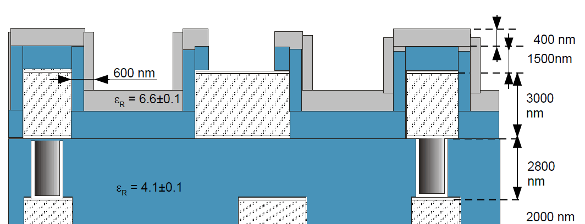

The planar stackup, with a thick block of SiO2 + passivation above the TopMetal2 top edge:
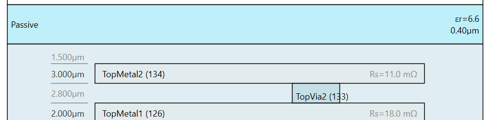

An alternative stackup, [openEMS_SG13G2_200um_passicut.xml](openEMS_SG13G2_200um_passicut.xml), leaves out the conformal cover over TopMetal2 and places the correct thickness of SiO2 and passivation only in the **valleys** between TopMetal2 shapes, cutting TopMetal2 about halfway. This avoids the overestimated sidewall capacitance of the planar stackup, and the extra effort of dielectrics conformal around TopMetal2.

> **Difference to FEM using gds2palace:** the fully conformal stackup of the gds2palace study is **not** used here. Its dielectric sidewalls are 600 nm thick and would need a very small refined_cellsize. For FDTD that drives up the cell count heavily. The "passivation cut" model, which the gds2palace study dropped, suits FDTD better. Different solver methods need different modelling strategies!

`run_L6n2_mergecorrection_passicut_sweep.py` runs this stackup with a 2 µm, 1 µm and 0.5 µm mesh at −60 dB. First at 2 µm, compared with the planar stackup at 2 µm (from `run_L6n2_mergecorrection_sweep.py`):

| Model (via merge + correction, −60 dB) | R @ 0.1 GHz | R @ 1 GHz | L @ 1 GHz | Peak Q | SRF | Solve time |
|---|---|---|---|---|---|---|
| Measured | 4.55 Ω | 4.86 Ω | 5.01 nH | 15.96 @ 4.71 GHz | 11.07 GHz | |
| Planar passivation, 2 µm | 4.70 Ω | 5.14 Ω | 4.90 nH | 13.39 @ 4.27 GHz | 9.60 GHz | 150 s |
| Passivation cut, 2 µm | 4.70 Ω | 5.12 Ω | 4.89 nH | 14.43 @ 4.72 GHz | 10.70 GHz | 233 s |

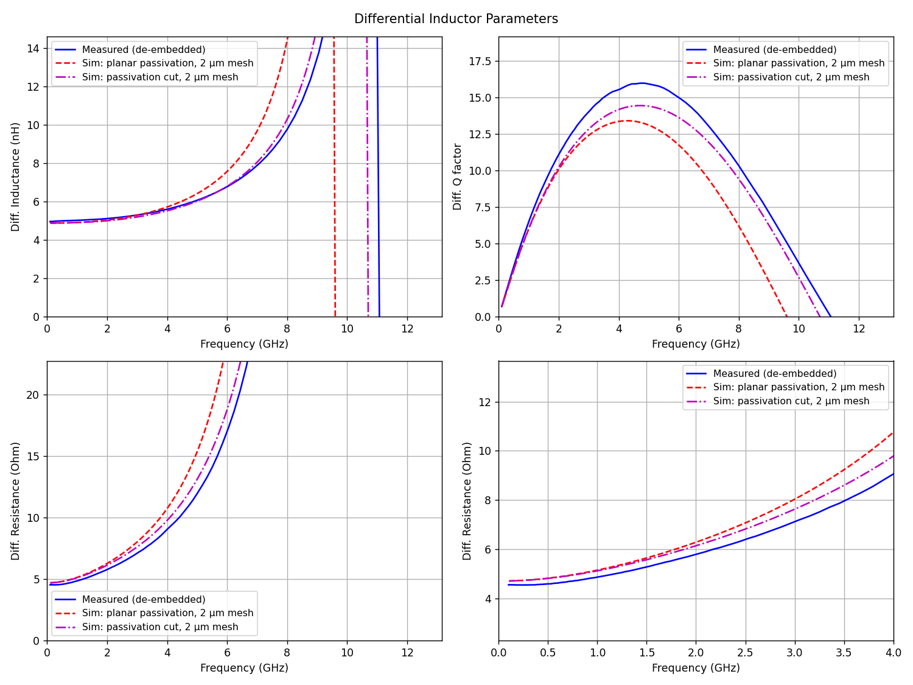

At the same 2 µm mesh, the cut passivation moves the SRF from 9.6 GHz to 10.7 GHz, and the peak Q from 13.4 at 4.3 GHz to 14.4 at 4.7 GHz, both closer to the measurement. The low-frequency resistance and the inductance do not change, as expected for a change of dielectric only.

Refining the mesh gives the final result:

| Model (passivation cut, via merge + correction, −60 dB) | R @ 0.1 GHz | R @ 1 GHz | L @ 1 GHz | Peak Q | SRF | Cells | Solve time |
|---|---|---|---|---|---|---|---|
| Measured | 4.55 Ω | 4.86 Ω | 5.01 nH | 15.96 @ 4.71 GHz | 11.07 GHz | | |
| 2 µm mesh | 4.70 Ω | 5.12 Ω | 4.89 nH | 14.43 @ 4.72 GHz | 10.70 GHz | 0.62 M | 233 s |
| 1 µm mesh | 4.71 Ω | 5.10 Ω | 4.90 nH | 14.68 @ 4.72 GHz | 10.99 GHz | 2.01 M | 428 s |
| 0.5 µm mesh | **4.68 Ω** | **5.04 Ω** | **4.91 nH** | **15.58 @ 4.90 GHz** | **11.13 GHz** | 7.93 M | 6,141 s |

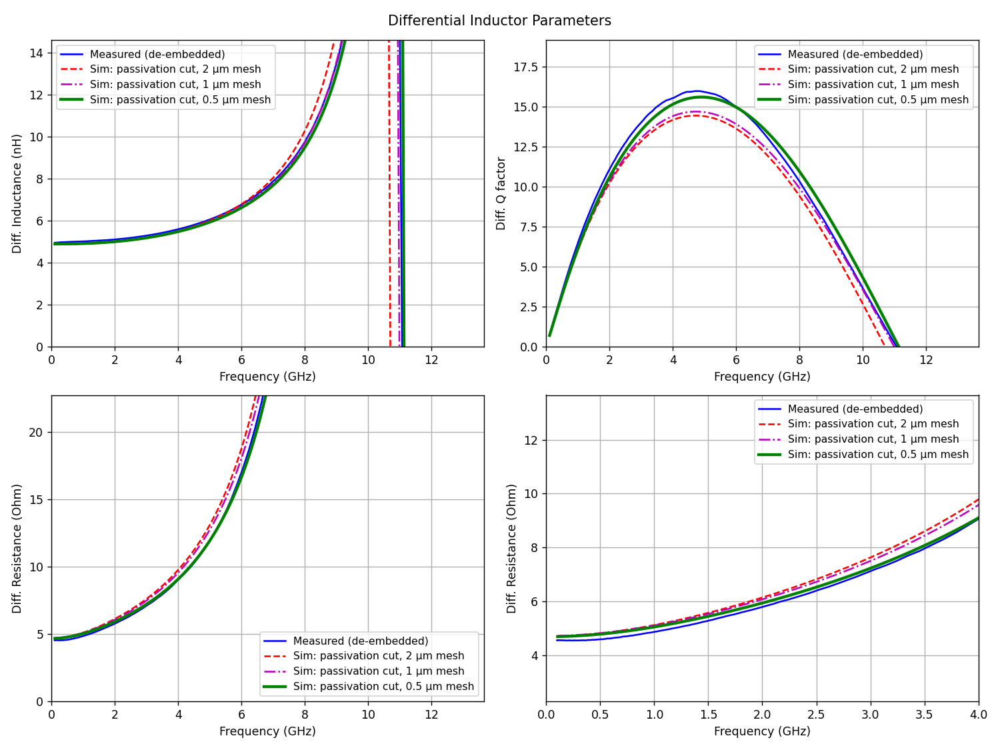

- **The final model (0.5 µm mesh)** is within 2.9 % of the measurement in low-frequency resistance, 2.1 % in inductance and 0.5 % in SRF, and 2.4 % low in peak Q.
- **The mesh matters for peak Q, as in the third step:** it rises by 1.7 % from 2 µm to 1 µm and by 6.1 % from 1 µm to 0.5 µm. With the step to 0.5 µm larger than the one before, peak Q is not shown to be converged even at 0.5 µm; a 0.25 µm model would take roughly 8× longer and was not run.
- **The 1 µm mesh is the practical setting:** 14× faster, with R, L and SRF within 1.3 % of the 0.5 µm model, but peak Q 6 % lower.

## Mesh size revisited: 1 µm vs. 2 µm

R at DC and L hardly depend on the mesh, and even refined_cellsize = 2 µm gives them well; peak Q needs a fine mesh (third and fourth step). These findings are **valid for this particular geometry with 8 µm line width and 4 µm gap**. For geometries with narrower gaps, a smaller refined_cellsize can be necessary, because it controls the "staircasing" of diagonal lines by the FDTD mesh.

If you go too coarse, the staircase mesh creates rough edges and even shorts across the gap. To illustrate that staircasing, the plots below show the calculated E field in the gap and the mesh line overlay at 1 µm and 2 µm, from `run_L6n2_mergecorrection_passicut_fielddump.py`.

| 1 µm mesh | 2 µm mesh |
|---|---|
| 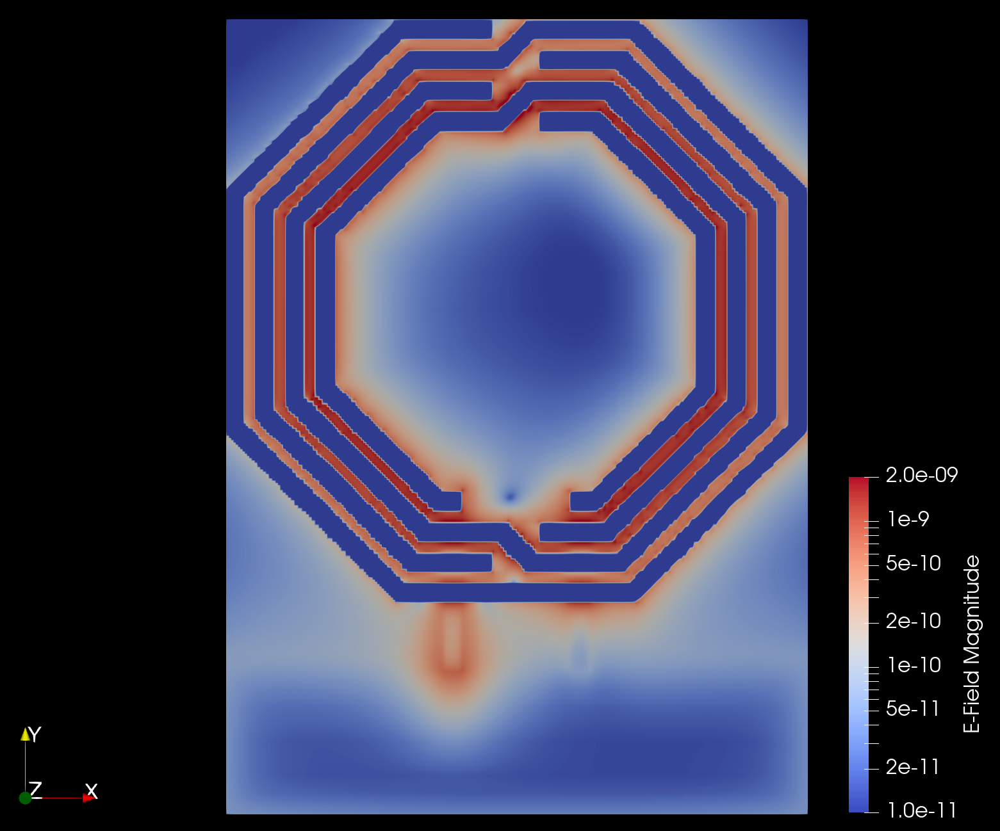 | 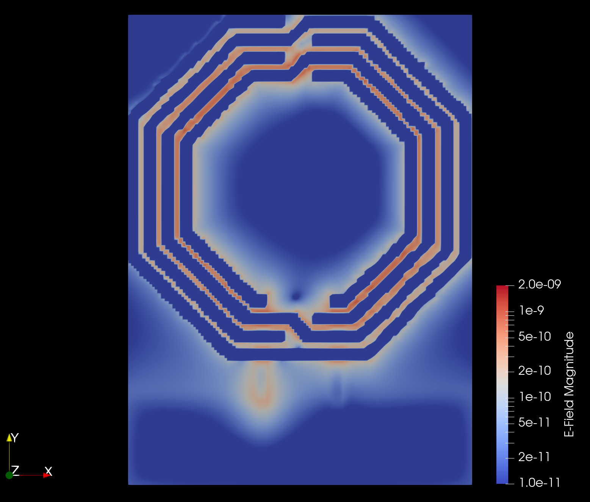 |
| 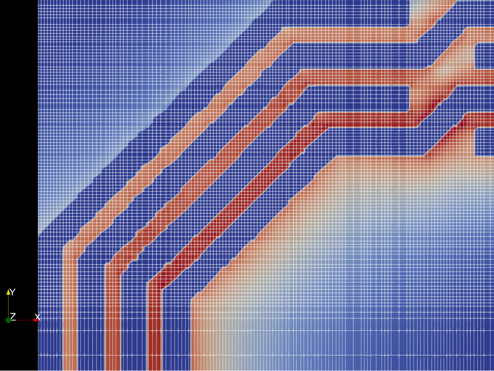 | 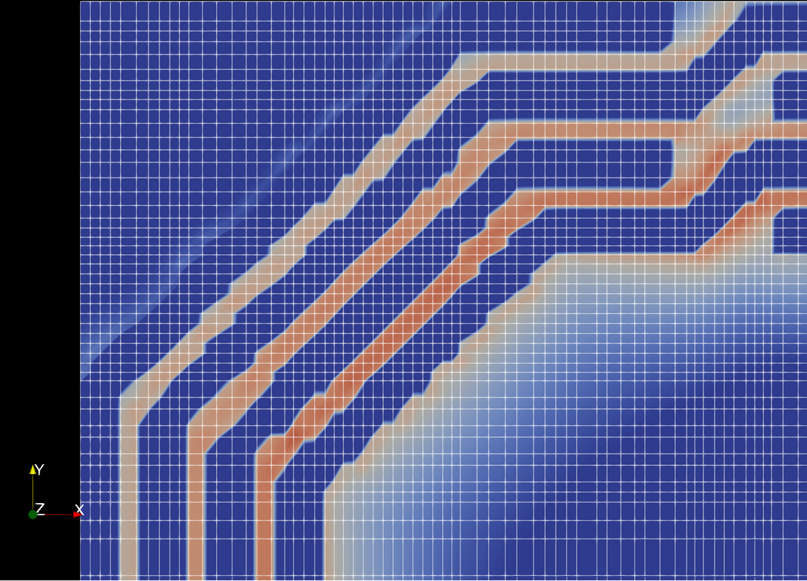 |

## Comparison: measurement, openEMS and gds2palace

The final models of both workflows, both with the passivation cut and with the simulation boundary far enough away:

- **openEMS:** passivation cut, via merge + correction, 0.5 µm mesh, −60 dB, PEC box with 250 µm margin and 800 µm air.
- **Palace:** PassiCut, filled metals (volume mesh), via merge + correction, 2 µm mesh, absorbing boundary with 400 µm margin and 800 µm air, Palace 0.19, from the [gds2palace L6n2 study](https://github.com/VolkerMuehlhaus/gds2palace_ihp_sg13g2/blob/main/more_examples/measured_vs_simulated/more_accurate_models_L6n2_v5/README.md) (v5). Its S-parameters are copied to `results/palace_L6n2_v5_2um_passicut.s2p`.

### Results

| Model | R @ 0.1 GHz | R @ 1 GHz | L @ 1 GHz | Peak Q | SRF |
|---|---|---|---|---|---|
| Measured | 4.55 Ω | 4.86 Ω | 5.01 nH | 15.96 @ 4.71 GHz | 11.07 GHz |
| openEMS: passivation cut, 0.5 µm mesh, −60 dB | 4.68 Ω | 5.04 Ω | 4.91 nH | 15.58 @ 4.90 GHz | 11.13 GHz |
| Palace: PassiCut, filled metals, 2 µm mesh | 4.69 Ω | 5.06 Ω | 5.02 nH | 15.80 @ 4.90 GHz | 11.08 GHz |

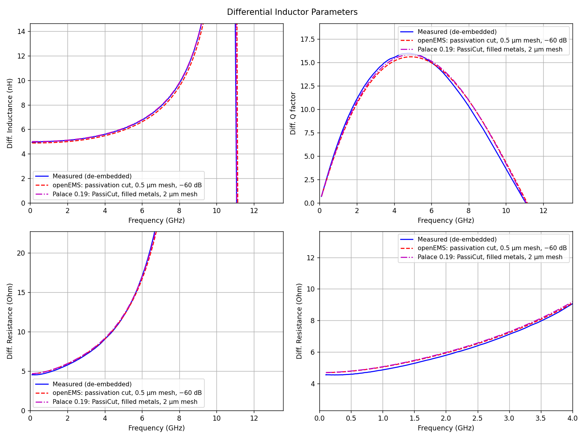

- **Palace** is within 0.2 % in L, 1.0 % in peak Q and 0.1 % in SRF of the measurement.
- **openEMS** is 2.1 % low in L, 2.4 % low in peak Q and 0.5 % high in SRF.
- **Both** are about 3 % high in low-frequency resistance, and agree with each other within 0.2 % there.
- **The two solvers agree within 1.4 % in peak Q**, at the same peak frequency (4.90 GHz), and within 0.5 % in SRF. With the 1 µm mesh, openEMS was 7 % lower in peak Q: the difference was the mesh, not the solver.
- **L is 2.3 % lower in openEMS than in Palace.** This difference is not explained yet; it does not change with the mesh or the box.

Both use the **"passivation cut" model** here: the correct SiO2 and passivation thickness in the valleys between TopMetal2 traces, without a conformal cover on top of and beside TopMetal2. The stackup files themselves differ, because the openEMS and Palace stackups follow different modelling rules. The gds2palace study recommends the full conformal passivation instead, which openEMS can't resolve at a practical cell size (see [the fourth error source](#fourth-error-source-the-passivation-over-topmetal2)). In Palace, the conformal model moves the SRF from 11.08 GHz to 10.83 GHz and peak Q from 15.80 to 15.61, at 4 min 5 s instead of 3 min 19 s.

Also note that the **meaning of refined_cellsize is different between both workflows**: in gds2openEMS it is about the **smallest** in-plane cell size; geometry detail below it is lost or clipped to the mesh (only thin layers still get smaller cells in z). In the gds2palace workflow, refined_cellsize is the **maximum** cell size along the edges of the conductors; the actual mesh for small details can be much finer, only limited by the geometry itself. Same parameter names, but different meaning, so you usually need different values when switching between the FDTD and the FEM workflow!

### Simulation time

The time for the full S-parameters over the whole sweep (openEMS: both port excitations), all on hpz2:

| Solver | Model | Time |
|---|---|---|
| Palace 0.19, 16 processes | PassiCut, 2 µm mesh | 3 min 19 s |
| Palace 0.19, 16 processes | conformal passivation, 1 µm mesh (the most accurate Palace model) | 8 min 6 s |
| openEMS, new CPU engine (experimental), automatic thread count | passivation cut, 2 µm mesh, 0.62 M cells | 3 min 53 s |
| openEMS, new CPU engine (experimental), automatic thread count | passivation cut, 1 µm mesh, 2.01 M cells | 7 min 8 s |
| openEMS, new CPU engine (experimental), automatic thread count | passivation cut, 0.5 µm mesh, 7.93 M cells (the final model) | 102 min 21 s |

- Palace with gds2palace 0.10.7 and its default `complex_coarse_solve`.
- openEMS built from its source code (1d710c2): the new CPU engine is not in an openEMS release yet. Its speed depends on the model size: 3.9 to 5.8 GCells/s for the 2 µm models (0.6 million cells), 7.0 to 7.7 GCells/s for the 1 µm models (2 million cells), and 2.3 to 2.5 GCells/s for the 0.5 µm models (8 million cells). See [`more_examples/gpu_test`](../../gpu_test/README.md) for the engines on other models and machines.

## Files

- `run_*.py`: the openEMS model scripts. Results go to `output/`, which is not in git. `run_L6n2_mergecorrection_passicut_boundary.py` runs the simulation box cases.
- `openEMS_SG13G2_750um_passicut.xml`: the passivation cut stackup with a 750 µm wafer (only the substrate is thicker), for the wafer on the chuck.
- `results/*.s2p`: the S-parameters used in this README. `palace_L6n2_v5_2um_passicut.s2p` is copied from the gds2palace study (`more_accurate_models_L6n2_v5`).
- `results/plot_study.py`: regenerates the L/Q/R plots in `results/plots/` from those files.
- `results/plot_time_signals.py`: regenerates the excitation spectrum and port voltage plots. It needs the raw time signals in `output/`, so rerun `run_L6n2_mergecorrection_sweep.py` first.
